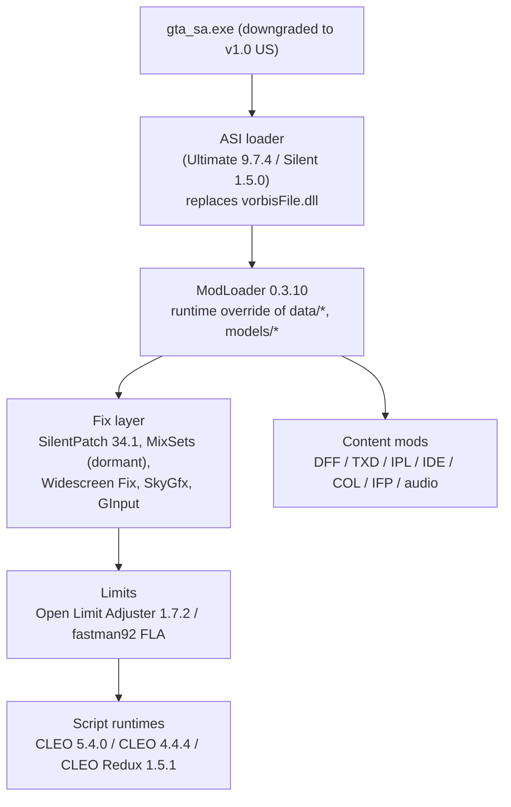
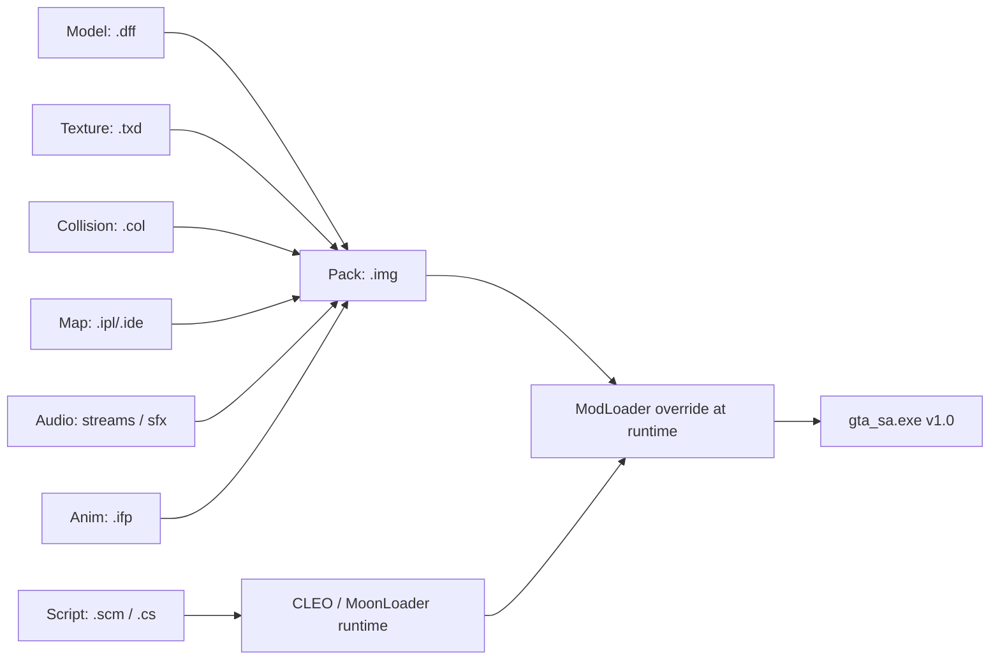
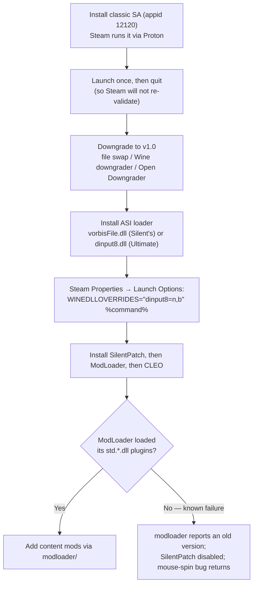

# GTA: San Andreas modding — state of the art (2026)

**Research date:** 2026-10-12 · **Subject:** the PC 2004/2005 RenderWare release
of *Grand Theft Auto: San Andreas* ("classic SA"), with the 2021 *Definitive
Edition* treated separately.

> **Reading note (corrected after verification).** Version numbers and release
> dates **for software components** are asserted only where a primary source
> (project release page, GitHub Releases API, official site, repository README)
> was inspected; anything unconfirmed is marked **unverified**. This does **not**
> hold uniformly across the document: the legal/enforcement material in §6 rests
> largely on **secondary press reporting** and is attributed to its outlet at
> each row. No download counts, player counts, or benchmarks are claimed, and no
> migration or market-share totals are asserted. Citation keys and their
> verification status are summarised in the **Verification notes** and
> **Removed Unsupported Claims** sections at the end; unresolved review findings
> are carried in **§8 Open questions**.

---

## Executive summary

- **The classic-SA stack is not a dead scene; it is a maintained, versioned
  toolchain whose core pieces all shipped releases in 2026.** Ultimate ASI Loader
  v9.7.4 (2026-08-16), ModLoader v0.3.10 (2026-08-08), SilentPatch SA Build 34.1
  (2026-08-15) and CLEO 5 v5.4.0 (2026-03-16) are all current [S16][S14][S12][S1].
- **The canonical install pattern is "downgrade to v1.0, then never touch game
  files":** ASI loader → ModLoader → fix layers (SilentPatch, Widescreen Fix,
  SkyGfx) → limit adjusters → content dropped into `modloader/`. Editing
  `gta3.img` directly is now the legacy path [S15][S43][S44].
- **Scripting is split across four live tracks, not one.** CLEO 4 (`.cs`) and
  CLEO 5 are the single-player runtimes, **CLEO Redux** (JS/TS, 1.5.1,
  2026-09-26) is the modern alternative, and **MoonLoader** (Lua) is the SA-MP
  client-script runtime [S1][S3][S5][S7].
- **The limits problem has an open-source answer** (Open Limit Adjuster
  v1.7.2, 2026-09-12) alongside the older closed-source reference,
  fastman92 Limit Adjuster [S23][S21].
- **SA-MP's original server infrastructure is defunct; open.mp is the active
  continuation.** `sa-mp.com` went down in **September 2023** (a
  community-reported date, not a first-party announcement — see §3), and open.mp
  describes itself as fully backwards compatible with existing SA-MP scripts and
  clients (v1.5.8.3079, 2025-12-17). The open.mp homepage also states players
  "join your friends **playing on the SA:MP client**", i.e. the SA-MP client
  remains part of the delivery path. MTA:SA is a separate, Lua-scripted lineage
  (v1.6.0, 2023-06-16) [S45][S46][S47][S48][S24]. **No migration total and no
  player counts are claimed — none exist (§3).**
- **Reverse engineering is where the legal risk is most durable.** The canonical
  re3 repository returns **HTTP 451** when fetched today (observed 2026-10-12)
  [S56]. Take-Two's April 2023 voluntary dismissal named the **Doe** defendants;
  whether the four named developers were also dismissed is **reported by press
  but not confirmed on the docket text** (§4.1, §7.11).
- **The 2024–2026 enforcement record gathered here** — a news-driven, non-random
  sample — is **consistent with** enforcement concentrating on *asset-bearing
  conversions and platform projects* (map/vehicle ports, browser and multiplayer
  platforms), with the re3 **source** repo still blocked as a counter-example.
  This is an inference about emphasis, **not** a finding that fix/tool projects
  are categorically out of scope (§6.2, §8). RAGE:MP was forced to shut down in
  May 2026, leaving FiveM as the only "authorized" GTA V multiplayer platform
  [S41-T4][S40-T4].
- **The Definitive Edition is a separate, thinner, more fragile modding stack**
  (Unreal Engine 4, 64-bit ASI, CLEO Redux x64, `.pak` assets). Classic
  ASI/CLEO4/limit-adjuster mods do not run on it [S37-T2][S19-T2][S20-T2].
- **On Linux the same stack is reported working, through Proton — but every step
  below is source-reported and none was reproduced on hardware (§10.8).** The
  classic Steam build (appid **12120**, version 3.0, delisted, Windows-only)
  runs under Proton at ProtonDB **Gold** [L12][L34]. A **v1.0 downgrade** is
  needed for any *Steam* install, Windows or Linux (§1.3); the **one genuinely
  Linux-only step** is **`WINEDLLOVERRIDES="dinput8=n,b" %command%`** so an
  Ultimate-ASI-Loader-style `dinput8.dll` loads [L9][L4][L3] — and Valve has since
  changed Wine to prefer the native DLL, so newer Proton may not need it.
  **ModLoader is reported failing on Proton/Wine for several users** (a small
  number of threads; cause unconfirmed) [L17][L19]. **No native-Linux *modding*
  path was found** — an unverified negative: `re3`/`reVC` cover GTA III and Vice
  City only, `gtasa-reversed` is a Windows DLL, and the only native SA builds
  located are an ARM64-only wrapper and a Unity reimplementation [L53][L54][L56][L57].
  See §10.

---

## 1. The baseline stack

### 1.1 Runtime and loader layer

| Component | Purpose | Latest confirmed (date) | Source |
|---|---|---|---|
| Ultimate ASI Loader | Proxy-DLL `.asi` loader (`dinput8.dll`, `vorbisFile.dll`, …) | **v9.7.4 (2026-08-16)** | [S16] |
| Silent's ASI Loader | Classic SA `.asi` loader (`vorbisFile.dll`) | **v1.5.0** (tag dated 2026-01-10; date ambiguous) | [S13] |
| ModLoader (LINK/2012) | Runtime injection from `modloader/`; **never modifies game files** | **v0.3.10 (2026-08-08)** | [S14][S15] |
| CLEO 5 | Single-player scripting runtime, `.cs`/`.cs4` | **v5.4.0 (2026-03-16)** | [S1] |
| CLEO 4 | Legacy runtime still required by older mods | **v4.4.4 (2023-08-13)** | [S3] |
| CLEO Redux | JavaScript/TypeScript runtime (also DE build) | **v1.5.1 (2026-09-26)** | [S5] |
| CLEO+ | `.cleo` plugin adding **318** opcodes to CLEO 4 (author-reported count) | **1.2.0 (2023-10-01)** | [S6] |
| MoonLoader | Lua (LuaJIT 2.1) runtime; SA-MP-oriented | **026 / "0.27" series — sources disagree on the label**; date **unverified** | [S7][S23-T4] |
| SAMPFUNCS | CLEO 4 add-on exposing SA-MP opcodes | **5.7.1** (medium confidence); date **unverified** | [S9][S10] |

Two loaders matter for a practical reason: ModLoader requires an ASI loader to
inject itself, so the stack is always "ASI loader first" [S15]. CLEO 5
explicitly "doesn't replace any original game file — the ASI Loader replaces
`vorbisFile.dll`", and its settings live in `CLEO\.cleo_config.ini` (added in
5.3.0) [S1].

**Two CLEO tracks, not one.** CLEO 4 (v4.4.4, 2023) and CLEO 5 (v5.4.0, 2026)
are both live. CLEO+ (v1.2.0) is a CLEO 4 add-on, and CLEO+ bundles parts of
`NewOpcodes.cleo` for backward compatibility [S6]. Community documentation
(gtacommunitydocs) links **CLEO 4.4.4** as the baseline even though CLEO 5
exists — a genuine, unresolved split in practice, not a documentation typo
(see §7.1) [S1][S3][S6][S26][S57].

**"MoonLoader is stalled" is a community assessment, not a
version-metadata fact.** The authoritative version endpoint returns `026` tagged
`beta` with no date [S7]; third-party listings have carried "0.27" since a
2019 upload [S23-T4]. The version is confirmed, the label and the currentness
assessment are not.

### 1.2 Fix and compatibility layers

- **SilentPatch** is the flagship fix layer ("a series of unofficial
  modifications … aimed at fixing bugs and improving compatibility with modern
  hardware", intentionally non-invasive), covering GTA III/VC/SA [S11]. It
  **went open-source on 27 October 2024** [S11] and shipped a 2026 update (posted
  2026-07-31) plus a **2026-08-15 "Hotfix #1"** (Build 34.1 for SA)
  [S11][S12][S52]. It explicitly targets SA 1.0 *and* the newer "newsteam/RGL"
  binaries [S20-T4].
- **MixSets** — an `.asi` with a large `.ini` exposing **285** author-declared
  fixes/tweaks — is still recommended by community docs as "the first mod you
  install in your ModLoader folder" [S57], but its own page's last update is
  **2022-05-03** (v4.3.7) [S19][S20]. Its author, Junior_Djjr, stated in 2024
  that he had left active SA modding [S17]. **This is the clearest "widely used
  but effectively dormant" component in the stack** (dormancy inferred from page
  dating + author statement; no formal discontinuation exists).
- **Open Limit Adjuster (OLA)** is open-source (MIT) and describes itself as a
  limit *purger* rather than a limit raiser; latest release **v1.7.2,
  2026-09-12** [S23][S19-T4].
- **fastman92 Limit Adjuster (FLA)** remains the reference for very large total
  conversions. Version **7.6** appears as the latest changelog entry, but there
  is **no dated release note for 7.6** (7.5 is dated 2024-06-05) — **version
  unverified**; the T1 and T4 research notes independently flagged the same gap
  [S21][S22]. Community guidance is that limits already owned by FLA must stay
  disabled in OLA, i.e. the two are not blindly stackable [S41].

### 1.3 Install practice

Two community guides from 2026 (a GitHub gist optimisation guide and gta.how)
give the same order: (1) downgrade to **v1.0 US**; (2) Ultimate ASI Loader;
(3) ModLoader; (4) SilentPatch; (5) Widescreen Fix; (6) SkyGfx; (7) GInput /
OLA / Project2DFX; (8) content via ModLoader [S43][S44]. The same guides state the
Steam/Rockstar Games Launcher (v3.0) builds "ARE NOT MOD COMPATIBLE" and should
be downgraded [S43][S44]. The Essential Pack (Junior_Djjr) bundles SilentPatch,
CLEO, ASI Loader, Widescreen Fix and ModLoader and was last updated
**01/10/26** [S26].

> **Caveat (secondary sources).** The v1.0-downgrade requirement and the "Steam
> build is not mod compatible" claim come from community guides, not from
> Rockstar. Treat as community consensus, well-evidenced but not first-party.

### 1.4 Architecture of the stack



---

## 2. File formats and the content pipeline

### 2.1 Formats

| Format | Holds | Typical tools | Editable |
|---|---|---|---|
| IMG (v2 for SA) | Sector-aligned archive (SA: directory + files in one `.img`) | IMG Tool 2.0, Alci's IMG Editor, IMG Factory 1.6, ModLoader runtime override | Yes (rebuild) |
| DFF | RenderWare binary-stream model/clump | ZModeler 3, Blender + DragonFF | Yes |
| TXD | RenderWare texture dictionary | Magic.TXD, DragonFF | Yes |
| IPL / IDE | Map item placement / item definitions (SA adds binary IPL) | MEd / Map Editor, text editing | Yes |
| COL | Collision models | DragonFF; Collision File Editor II | Yes |
| IFP | Animation packages (SA added v2, still reads v1) | IFP Editor 0.95b | Yes |
| Audio streams / SFX | SA dynamic radio streams; `sfx.raw`/`sfx.sdt` banks | SAAT 1.10 (+ Alci's GUI) | Yes |
| SCM | Compiled game scripts (`main.scm`, `script.img`) | Sanny Builder 4 | Yes (recompile) |

Sources: [S29][S30][S31][S32][S33][S34][S35][S36][S37][S38][S39] (GTAMods Wiki format pages; index: [S53]), [S40] (SAAT), [S15] (ModLoader);
per-tool pages for the editors named above are in the T4 research file
([S9-T4][S10-T4][S11-T4] for IMG tools; [S1-T4][S2-T4] models; [S4-T4] TXD;
[S13-T4] map; [S15-T4] animation; [S6-T4][S8-T4] audio; [S22-T4] SCM).

### 2.2 Creation tooling

| Tool | Purpose | Current version (date) |
|---|---|---|
| ZModeler 3 | Native RenderWare (III/VC/SA) and RAGE (IV/V) model import/export; DAE bridge | **3.3.1.1244 (2026-02-14)**, paid, 14-day trial [S1-T4] |
| DragonFF (Blender add-on) | Import/export `.dff`, `.col`, `.ide`/`.ipl`; TXD import/export | **v1.1.0 (2025-09-22)**, Blender 4.2 LTS+ [S2-T4][S3-T4] |
| Magic.TXD | TXD editor (PC/PS2/Xbox/GC/mobile), mipmap generation | **v1.1** (wiki-reported) [S4-T4] |
| MEd / Map Editor | Place/edit map objects via IPL/IDE | wiki/tutorial updated 2020 [S13-T4] |
| SAAT + GUI | Import Ogg Vorbis into SA streams, WAV into SFX | **v1.10** / GUI v1.0 [S6-T4][S8-T4] |
| IFP Editor | Import/export/replace animations | **v0.95b** [S15-T4] |
| Sanny Builder 4 | SCM/CLEO compiler, disassembler, editor | current [S22-T4] |
| OpenIV / GIMS Evo / Sollumz | GTA IV/V (RAGE) model & collision round-trip via openFormats | OpenIV 4.1; Sollumz active [S25-T4][S26-T4][S27-T4] |

**The modern pipeline has partly moved off ZModeler.** Blender + DragonFF now
handles RenderWare natively, and GTA IV/V assets are imported with
Sollumz/GIMS Evo/OpenIV openFormats and then down-converted to `.dff`/`.txd`.
T4's researcher flags an important honesty point: **this end-to-end
IV/V → SA down-conversion path is inferred** from the tools' capabilities and
from long-running community conversion threads, not documented by any single
source [S29-T4][S58-T4].

### 2.3 Stage map



---

## 3. Multiplayer and servers

Three things are routinely conflated under "GTA SA multiplayer" [S45]:

| Platform | Scripting | Status (as of 2026-10-12) | Source |
|---|---|---|---|
| **SA-MP** | Pawn (server), C++ plugins | **Original infrastructure defunct.** Last main-branch release **0.3.7 (2015-05-01)**; last client **0.3.7-R5** (community-listed, *not* first-party); MySQL server lists shut down Nov 2019 (forum-reported) | [S45][S20-T3] |
| **open.mp** | Pawn + C++ SDK + C API | **Active.** RC1 2023-01-05; open-sourced 2023-01-09; latest **v1.5.8.3079 (2025-12-17)**; dev continues into 2026 | [S46][S47] |
| **MTA:SA** | Lua (client + server) | **Active, slower cadence.** Latest stable **v1.6.0 (2023-06-16)**; 1.7 in development | [S48][S49][S24] |

**Timeline of the SA-MP collapse and open.mp rise.** Kalcor confirmed he had
stopped developing SA-MP (Oct 2019); a security update shut old server lists
(2019-11-25, community-reported); the SA-MP wiki went offline (late Sept 2020);
open.mp shipped RC1 (2023-01-05) and was open-sourced (2023-01-09); open.mp
1.1.0.2612 left the RC phase (2023-11-10); v1.5.8.3079 (2025-12-17) added
built-in controllable NPCs, a C API/SDK, and OpenSSL 3.0.13 [S45]–[S47].

**The `sa-mp.com` shutdown date is community-reported, not first-party.** The
claim "**September 2023**" originates from `sa-mp.mp`, a site whose stated
purpose is to be "the sole official SA-MP successor" and which therefore has an
interest in that framing [S45]; `open.mp`'s homepage does **not** mention the
date (the earlier draft cited it as if it did — corrected). The corroborating
record is a 2023-10-03 Wayback capture of an r/samp "SA-MP JUST WENT DOWN"
thread, i.e. the **exact day is unverified** and the month rests on that
community signal plus the successor site [S20-T3][S45]. Treat as "late Sept /
early Oct 2023, community-reported".

**open.mp's backwards compatibility is a project self-claim.** Its homepage
states it is fully backwards compatible with existing SA-MP scripts and clients
[S46]; no independent compatibility test or third-party confirmation was found.
This claim alone cannot support any statement about how many servers or players
moved.

**Scripting idiom is the practical divide:** SA-MP and open.mp use **Pawn**
(open.mp: "We've stuck with pawn"), while MTA:SA uses **Lua** [S46][S48].
open.mp additionally exposes a C++ SDK and, since v1.5.8, a C API [S47].

**Community platforms** where activity and downloads actually happen today:
GTAForums (+GTAGarage), MixMods (self-described largest SA mod site in Latin
America), gtaall.com, libertycity.net, ModDB, GTAinside, plus the open.mp and
MTA forums and their Discord communities [S31-T3]–[S37-T3][S1-T3][S30-T3].

> **Do not quote player counts.** No official SA-MP/open.mp/MTA total was found.
> The only ecosystem-wide figures located came from a community dashboard post
> whose author explicitly disclaims authority and admits AI-assisted
> interpretation — **unverified** [S12-T3].

---

## 4. Reverse engineering and major overhauls

### 4.1 The re3/reVC legal flashpoint

- **2021-02-19** — Take-Two files a DMCA notice against `github.com/GTAmodding/re3`
  and, per the notice, GitHub processes it **"against the entire fork network"**
  (`re3-nx`, `re3-vita`, `re3-wiiu`, `re3-psp`, …) [S1-T2].
- **2021-05-11** — GitHub restores a fork after a counter-notice [S5x].
- **2021-09-02** — complaint filed, N.D. Cal. **3:21-cv-06831-TSH**, naming
  Angelo Papenhoff (aap), Theo Morra, Eray Orçunus and Adrian Graber [S2-T2].
- **2023-04-04/05** — Take-Two files a **voluntary dismissal of the Doe
  defendants** (Doc. 49/50). What that document says about the four **named**
  defendants is **disputed between the two upstream research facets** (T2 reads
  the docket as dismissing the Does; T4 records the named developers as
  dismissed with prejudice and the Does without prejudice). Press reported that
  the claims against the four lead developers were dropped [S3-T2][S3x][S4x].
  **This brief therefore does not assert the named-defendant outcome as fact**
  (see §7.11, §8).
- **Observed 2026-10-12** — `https://github.com/GTAmodding/re3` returns
  **HTTP 451 Unavailable For Legal Reasons** when fetched. Verified
  independently by the lead (fetch tool) and by the T2 researcher (`curl`) [S56].

The lesson the ecosystem drew: reverse-engineered *source* is the highest-risk
artifact class, and mirrors/forks are how the work survives (e.g.
`Jai-JAP/re-GTA`, `Hezkore/hez-gta-re3`, `novawish/re3`) [S7-T2].

### 4.2 Active SA-specific reverse engineering

- **`gta-reversed/gta-reversed`** builds an injectable DLL that replaces SA 1.0
  US functions with reversed ones; its README estimates **~50–60% reversed**
  (self-reported) with no completion estimate, and it requires a specific
  "Compact exe" of exactly 5,189,632 bytes [S54]. Its build requirements
  reference Visual Studio 2026, indicating ongoing 2026 activity [S54].
- **`librw`** is an MIT-licensed RenderWare reimplementation used as re3's
  renderer backend [S28].
- **A new 2025–2026 vector is LLM-assisted RE.** The `Dryxio` org publishes
  `ReAgent` (Ghidra-driven decompilation assistant), `Ghidra Bridge`, `Ariane`
  (map editor), and a `plugin-sdk-sa` fork whose README says it uses the
  project's "complete reverse-engineered codebase" with "LLM-assisted" analysis.
  **This is a self-claim with no independent verification — treat as
  unverified** [S55].

### 4.3 Overhauls and total conversions

| Project | Type | Status (2026-10-12) |
|---|---|---|
| GTA: Underground (+ UG-MP) | SA+III+VC+Bully+Manhunt mega-map TC | **Ceased 2021-09-04** over "increasing hostility"; last official snapshot 4.2 (2021-08-28) [S23-T2][S24-T2][S25-T2] |
| Project Eagle | Multi-city USA map TC | **Active**; ModDB news 2025-04-29 [S26-T2] |
| SAxVCxLC | VC + LC maps inside SA | Long-running; posts through 2026-06 [S33-T2] |
| GTA: Recall San Andreas | Beta restoration / remaster | Released (announced 2025-02-19); **medium confidence** [S31-T2] |
| OpenLiberty | GTA III map → SA | **Dormant** ("dead mod", 2022) [S34-T2] |
| SA Community Cutscene Fixes | Community cutscene/gameplay fixes | Maintained [S35-T2] |

> **Correction from research:** the brief's example project "SA Community Patch"
> **does not exist under that name**. The nearest real projects are *SA Community
> Cutscene Fixes* and the older *GTA San Andreas – Unofficial Patch* [S35-T2].

---

## 5. Definitive Edition vs original PC

| Dimension | Original PC (2005) | Definitive Edition (2021) |
|---|---|---|
| Engine | RenderWare 3.6 (D3D9) | **Unreal Engine 4** [S37-T2] |
| Release | NA PC **2005-06-07** (PS2 2004-10-26) [S36-T2] | Windows **2021-11-11**; Steam **2023-01-19** [S37-T2] |
| Mod baseline | Downgraded **1.0 US** exe | Version-specific; title updates move offsets (e.g. 1.112) [S39-T2] |
| Code mods | ASI, CLEO 4, ModLoader, limit adjusters, SilentPatch, MixSets — mature | **Classic ASI/CLEO4/limit-adjuster mods do not work** |
| Scripting | CLEO 4 (`.cs`) | **CLEO Redux x64** (JS/TS) [S19-T2] |
| Assets | DFF/TXD/IMG via tools/ModLoader | UE4 **`.pak`** packages under `Gameface\Content\Paks` [S20-T2] |
| Widescreen/HUD | ThirteenAG `gtasa` Widescreen Fix | `GTASADE.FusionFix` [S18-T2] |
| Mod fragility | *Judgment:* lower (static binaries) | *Judgment:* **higher** — each title update risks breaking mods [S46-T4][S47-T4] |

Patch history: 1.0 (2021-11-11) → 1.03 (2021-11-30) → 1.04 (2022-02-28) →
1.04.5 (2022-10-18) → **1.112 (2024-11-12/13)**, which added **Classic Lighting
mode** [S39-T2][S46-T4]. The fragility is not theoretical: **CLEO Redux 1.3.0
(2024-11-24) had to add support for "the latest GTA: The Trilogy patch"** after
1.112 shipped [S47-T4]. DE mods live largely on Nexus Mods (game id
`grandtheftautothetrilogy`), with a widely-linked "Proper Definitive Edition for
San Andreas" guide dated **2025-08-05** [S47-T2].

> GTAForums returns **HTTP 403** to our fetcher, so that guide's exact contents
> are **unverified** — only its title and date are known from the search index
> [S47-T2].

---

## 6. The 2024–2026 ecosystem and legal landscape

### 6.1 Dated enforcement timeline

**Sourcing note:** unlike §1–§5, most rows here rest on **secondary press
reporting**, attributed per row. Where a primary instrument was located it is
named.

| Date | Event | Source (secondary unless noted) |
|---|---|---|
| 2024-11-12/13 | DE title update 1.112 (Classic Lighting); DE script runtimes must catch up | SteamDB patchnotes + CLEO Redux changelog (primary) [S46-T4][S47-T4] |
| 2024-12-18 | *Take-Two v Anderson (No 2)* [2024] FCA 1459 (Australian TPM/"Infamous Mod" case; Rockstar lacked standing on the TPM claim; reasons confidential until 2025-01-28) | court judgment (primary, via AustLII mirror + law-firm case note) [S32-T4][S33-T4] |
| 2025-01-15 | **Liberty City Preservation Project** (GTA IV LC in GTA V) taken down | Insider Gaming (403 to fetcher; corroborated GameSpot/RockstarINTEL) [S34-T4] |
| 2025-01 (late Jan) | **Vice City Nextgen Edition** released *despite* takedowns (channel/trailer removed); exact day reported by 80.lv, not first-party | IGN / 80.lv [S35-T4] |
| 2025-03-04 | GTA V "Enhanced" PC release splits the mod scene; Script Hook V needs per-edition builds | Rockstar Newswire (primary) + dev-c.com [S44-T4][S28-T4] |
| 2025-04-02 | Take-Two DMCAs a video of a GTA V mod containing GTA VI map content | Techdirt [S36-T4] |
| 2025-12-26 | Take-Two DMCAs a browser-based Vice City port (TPM circumvention + trademark claims) | Tom's Hardware via Yahoo Tech [S39-T4] |
| 2026-02 → 2026-07-06 | **alt:V** (GTA V MP platform) forced into staged wind-down — single secondary source; instrument reported as a Take-Two *request*, not a judgment | RockstarINTEL / gta-zone [S40-T4] |
| 2026-03-26 | C.D. Cal. **denies Take-Two's motion to dismiss** PlayerAuctions' DMCA § 512(f) counterclaim over an Apr-2024 takedown notice | court order (primary) [S43-T4] |
| 2026-05-25/26 | **RAGE:MP** announces shutdown at Take-Two's request; **FiveM is the only "authorized platform"** for GTA V multiplayer modding | Kotaku [S41-T4] |
| 2026-08-18/21 | GTA VI leak DMCA takedowns + SDNY DMCA subpoenas | Insider Gaming / GamerFuzion [S42-T4] |
| 2026-09-30 | **Reported** action against the modders behind an unofficial GTA V Switch port — **low confidence, single X-derived source** | TwistedVoxel [S57-T4] |

### 6.2 What the pattern suggests for classic SA — an inference, not a finding

**Read the following as a hypothesis, not a scope ruling.** The events above are
a **news-driven, non-random sample**: they are the enforcement actions that got
covered, not an exhaustive docket. On that evidence, enforcement *emphasis*
sits on **asset-bearing conversion and platform projects** — the sampled
takedowns are map/vehicle conversions and browser/multiplayer platforms, and the
surviving fix/tool projects (SilentPatch, ModLoader, CLEO, DragonFF, OLA) are
public repositories still receiving releases [S11][S12][S14][S23].

Two honest limits on that reading:

1. **It is a survivorship argument.** "These projects were not taken down" is
   consistent with low legal exposure, *or* with the owners simply not having
   been targeted yet. Absence of takedowns over ~2 years does not establish that
   fix/tool projects are categorically out of scope.
2. **It is already contradicted by one case in this report.** Reverse-engineered
   **source** is *not* an asset-bearing conversion, yet `GTAmodding/re3` remains
   `HTTP 451` today [S56]. So "asset-bearing" is at best a *partial* predictor;
   source-level reimplementation is a second, independent risk class.

**Sustainability looks asymmetric** on the evidence gathered: curated *pipelines*
(format specs on GTAMods Wiki, open-source tools with public repos) have proven
durable; asset-heavy *conversions* are over-represented among the projects that
went dark [S34-T4][S39-T4]. GTAGaming/GTA4-Mods converted their files into a
static archive when that network shut down, and the Internet Archive is used as
a fallback host for SA mod packages [S48-T4][S49-T4]. The formal literature
framing modding as a contested copyright/fair-use/licence zone is available but
does not address GTA SA specifically [S50-T4][S51-T4].

---

## 7. Disagreements, conflicts, and unverified claims

1. **CLEO 4 vs CLEO 5.** Community docs link CLEO 4.4.4 as baseline while
   cleo.li lists CLEO 5.4.0. Both are current; CLEO+ is bound to CLEO 4. This is
   a real ecosystem split, not a documentation error [S1][S3][S6][S26][S57].
2. **ModLoader version confusion.** The 2018 `v0.3.7` build still circulates on
   GTAGarage, but the maintained GitHub repo is at **v0.3.10 (2026-08-08)**.
   Cite the repo, not the mirror [S14][S25].
3. **fastman92 Limit Adjuster 7.6 date.** The changelog lists 7.6, but there is
   no dated release note (7.5 = 2024-06-05). The artifact-heavy download is a
   MediaFire archive with no release metadata. **Version accepted, date
   unverified** [S21][S22].
4. **MixSets is "essential" yet dormant.** Community docs call it the first mod
   to install; its own page hasn't been updated since 2022-05-03 [S19][S26][S57].
5. **"SA Community Patch" does not exist under that name** [S35-T2].
6. **Dryxio's "complete reverse-engineered SA codebase"** is self-reported only
   [S55].
7. **`sa-mp.mp` self-describes as "the sole official SA-MP successor"**, but
   open.mp community members dispute the "official" framing. Self-claim;
   **unverified** [S45].
8. **The `sa-mp.com` September 2023 date is community-reported and
   single-sourced to a self-interested successor site**, with only a
   2023-10-03 Wayback capture as corroboration; the exact day is unverified
   [S45][S20-T3].
9. **No official multiplayer player counts exist**; the one aggregate figure
   found is from an explicitly non-authoritative community dashboard [S12-T3].
10. **Version numbers in search snippets lag the source of truth.** Mirror sites
    showed SilentPatch "v.33.1" and Ultimate ASI Loader "v.9.7.0"; the GitHub
    Releases API on 2026-10-12 gave 34.1 and 9.7.4 [S16][S1]. The MoonLoader
    "0.27" listing (2019) vs the endpoint's `026` is the same class of drift.
11. **The re3 dismissal has two incompatible readings across the research
    facets** (named defendants dismissed with prejudice vs. only the Does
    dismissed), and the brief does not resolve it. **Unresolved; requires the
    docket text** [S3-T2][S3x][S4x].
12. **Blocked sources (recorded, not silently dropped):** GTAForums returns
    HTTP 403 to our fetcher; `steamdb.info/app/12120/patchnotes/` returns 403;
    `insider-gaming.com` returns 403; `gtamods.com/wiki/Audio`,
    `/Sound_Effects` and `/Streaming_Audio` return 404 (correct pages are
    `Audio_stream` and `SFX_(SA)`).

---

## 8. Open questions

**Carried from the independent reviewer pass (MAJOR findings, unresolved).**

- **M1 — How far does the enforcement thesis generalise?** §6.2 is an inference
  from a non-random, news-driven sample and is contradicted by re3's ongoing
  `HTTP 451`. A defensible version needs either an exhaustive takedown record or
  an explicit scope statement from the rights holder. Not resolvable from the
  current evidence [S56][S34-T4].
- **M2 — Sourcing discipline is uneven.** §1–§5 rest on primary sources; §6
  rests mostly on secondary press. The reading note now says so, but a future
  revision should either obtain primary instruments (DMCA notices, court
  filings) for each §6.1 row or split §6 into a clearly labelled "press-reported
  timeline" [S40-T4][S41-T4].
- **M3 — re3 dismissal detail.** Named defendants vs. Does must be settled from
  the docket (Doc. 49/50), not from press summaries [S3-T2][S3x].
- **M4 — open.mp compatibility is unverified beyond the vendor claim.** A real
  test (run a stock SA-MP gamemode unmodified on open.mp and measure breakage)
  would convert the self-claim into evidence [S46].

**Domain open questions.**

- **Does CLEO 5 fully supersede CLEO 4 for single-player mod compatibility, or
  is CLEO 4 permanently required as a compatibility layer?** Evidence is
  currently split (§7.1).
- **Is MixSets effectively unmaintained?** Author statements and page dating
  suggest yes; no formal discontinuation exists [S17][S19].
- **What is the canonical GTA IV/V → SA asset down-conversion path?** No single
  source documents it end-to-end; T4 marks it as inference [S29-T4].
- **How large is the classic-SA modding population today?** No verifiable
  figure was found; every number encountered was unauthoritative.
- **What happens to the classic stack if Rockstar changes the Steam/RGL build
  again?** SilentPatch already targets "newsteam/RGL" binaries, implying the
  classic distribution has changed once; no dated patch note was verified
  [S20-T4].

---

## 9. Next steps

1. Pin each tool's version to a **GitHub Releases API read** rather than a
   mirror page, and re-run that read before any republication.
2. Resolve §7.1 (CLEO 4 vs 5) by testing a representative sample of popular
   CLEO 4 mods under CLEO 5.4.0 on a v1.0 install — this is a testable
   experiment, not a documentation question.
3. Resolve §7.3 by fetching the FLA 7.6 archive metadata directly.
4. Resolve §7.11 / M3 by pulling N.D. Cal. Doc. 49/50 from the docket.
5. Resolve M4 by running an unmodified SA-MP gamemode on open.mp and recording
   the failure set.
6. Establish a dated, citable archive snapshot of the "essential stack" so
   future runs can measure drift rather than re-derive consensus.

---

## 10. Linux, Steam and Proton (increment 2)

**Scope of this section.** The *classic* Steam build of GTA: San Andreas
(Steam **appid 12120**) run under Proton; the Definitive Edition (**appid
1547000**) is mentioned only where it differs. No game installation was
available to this research, so every "this works" statement below is
**source-reported**, not reproduced on hardware.

### 10.0 Short answer

The classic Steam build is a **Windows-only, delisted** title
(`platforms.linux = false`), so on Linux it runs through **Proton**, and the mod
stack is **reported working** — read that as **source-reported throughout;
nothing in this section was reproduced on hardware** (§10.8). Two steps are
needed, and **only one is Linux-specific**: a **downgrade to v1.0**, which any
*Steam* install requires on any OS because the Steam build is version 3.0
(§1.3), and a **DLL override** to let a local `dinput8.dll` load, which is the
Linux-only step [L32][L34][L64][L22]. No native-Linux *modding* path for San
Andreas was found: the well-known `re3`/`reVC` source ports cover GTA III and
Vice City only ([L53], §10.5). This is an **unverified negative**, not a proof of
impossibility (§10.9 item 9).

### 10.1 Does the un-modded Steam build run under Proton?

| Claim | Value | Evidence | Confidence |
|---|---|---|---|
| It launches | Valve's own Proton tracker thread for "GTA: San Andreas (12120)" has been open since 2018 and opens with "Launches without any errors… Just works" | [L1] | primary (tracker) |
| ProtonDB tier | **Gold** (summary API: score 0.71, `total: 290`, best reported Platinum, trending Gold) | [L12] | primary (ProtonDB API) |
| Aggregator snapshot | Gold, "recommended Proton **9.0-3**", 275+ reports, last verified **2026-05-11** | [L10] | secondary (one aggregator's snapshot) |
| Real builds in use | ProtonDB reports name **GE-Proton11-6** and **GE-Proton11-1**; GE-Proton's own latest releases are **11-7 (2026-09-16)** and **11-6 (2026-08-28)** | [L11][L14] | community-reported |
| Wine AppDB | Steam build **Gold** (best test 7.10-staging); current Steam build is **version 3.00** | [L15] | primary (Wine AppDB) |

> **ProtonDB's own page could not be fetched** (`BLOCKED:
> https://www.protondb.com/app/12120`, JS-rendered). The tier above comes from
> ProtonDB's **summary JSON API** [L12], and the build names from a search-provider
> extraction of the report page [L11]. Do not treat "9.0-3" as a requirement;
> it is one aggregator's snapshot.

**Rockstar Games Launcher dependency — the Steam build does not need it.**
SilentPatch maintains **separate "Steam" and "RGL" targets**, and added explicit
RGL support in 2019, which only makes sense if they are different builds [L28][L29].
A community thread on whether the Steam trilogy requires RGL answers "no"
[L71] (community discussion, snippet-level — **low confidence**). **No
first-party statement was found** — label community/observed.

### 10.2 The DLL-override requirement (the key Linux mechanic)

Two ASI loaders matter, with **different mechanics**:

- **Silent's ASI Loader** replaces the game's own **`vorbisFile.dll`** (shipping
  `vorbisFile.dll` + `vorbisHooked.dll`) [L5][L66]. Its general setup
  instructions prescribe an override only for `dinput8.dll` [L4].
- **Ultimate ASI Loader** is a **proxy DLL**; for SA the useful name is
  **`dinput8.dll`** [L6]. Wine does not prefer a local `dinput8.dll` sitting
  beside the exe, so an override is needed [L3][L4].

**The override, verbatim, from the mod author's own documentation** [L4]:

```
WINEDLLOVERRIDES="dinput8=n,b" %command%
```

placed in Steam → Properties → Launch Options, or set permanently per prefix:

```
WINEPREFIX="$HOME/.steam/steam/steamapps/compatdata/12120/pfx" winecfg
```

→ **Libraries** tab → add `dinput8` as `native, builtin` [L4][L16].

- **This is documented by the SilentPatch author**, the Open Downgrader wiki,
  and Valve's Proton issue tracker — three sources agree on the string
  [L4][L9][L3]. They are **not fully independent**: the Open Downgrader bundles
  SilentPatch and mirrors its launch-option instructions, so this is
  corroboration, not three independent confirmations.
- **Proton may no longer need it.** Valve Proton issue **#7974** ("Whitelist
  dinput8.dll as native, then built-in by default") was **closed as completed**,
  implemented by `ValveSoftware/wine` commit
  `09af566a7fbaa075eaeaa76468c7344bdbeeafda` (commit dated 2024-11-29; issue
  closed 2024-12-17) [L3]. *Inference:* recent Proton builds may already
  whitelist it; do not remove the launch option until verified on your own build.
- **`native,builtin`** means "use my file first, fall back to Wine's builtin"
  [L4][L16]. No source read requires the reverse ordering for SA [L8].

> **Unresolved discrepancy.** Primary install docs for Silent's loader do **not**
> mention an override [L4][L5], yet at least one ProtonDB report runs
> `WINEDLLOVERRIDES="vorbisFile=n,b"` (another adds `bass`) [L11]. The override
> for the `vorbisFile.dll` route is **community-reported only**.

### 10.3 Downgrading to v1.0 from Linux

The Steam build is **3.0** ("NewSteam r2", 2014-12-09), which is only partly
moddable; v1.0 is the modding target [L15][L22]. Five reproducible options:

| # | Method | How it works from Linux | Evidence | Confidence |
|---|---|---|---|---|
| 1 | **File-swap downgrader** (TJGM zip of 1.0 files) | Launch the game once, then copy the archive's files over `…/steamapps/common/Grand Theft Auto San Andreas`, replacing existing files. Platform-agnostic. | [L22][L23][L24] | high (multiple guides agree) |
| 2 | **Windows downgrader under Wine** (`GTASA_12-9-14_Steam_to_V1_DG.exe`) | `wine ./GTASA_12-9-14_Steam_to_V1_DG.exe`, then paste `~/.steam/steam/steamapps/common/` into the installer's path box | [L23] | medium (guide-level) |
| 3 | **Linux-native script** | `Dylanve151/GTA-SA-STEAM-LINUX` provides `install.sh` + a Linux `jptch` binary that re-implements the SA downgrader's `install.bat` | [L25] | medium (single repo, self-reported) |
| 4 | **Manifest pinning** (DepotDownloader) | SteamDB → depot → record manifest ID → `DepotDownloader -app 12120 -depot <id> -manifest <id> -username you -dir <out>`. The legacy console `download_depot` is reported **retired for old manifests** after Valve's 2021 manifest-request-code change. | [L26] | medium (tool docs + community guide; **steamdb.info returned HTTP 403**) |
| 5 | **GUI: GTA SA Open Downgrader** | Open-source, "inspired by the original RockstarNexus Downgrader"; converts **NewSteam R2 (Global & German) → v1.0 US (Hoodlum)**; wiki states support for **Windows, Linux, or Steam Deck**, and emits a launch option to paste into Steam properties. Repo carries `bin/xdelta3_linux` + `linux_tools.py`; advertises "Linux glibc 2.38+". Bundles ASI Loader, ModLoader, SilentPatch, Widescreen Fix, SkyGFX, Frontend, Framerate Vigilante, GInput, Project2DFX. | [L9][L65] | medium-high (project's own repo + wiki; not independently reproduced) |

**Two caveats that bite on Steam specifically:**

1. **Steam file verification reverses the downgrade** — expected, because Steam
   re-downloads its current files; re-run the downgrader afterwards. Steam can
   also replace the optional multiplayer launcher [L9].
2. **Saves are not interchangeable.** v1.0 save format differs from the
   Steam 2.x/3.x format; guides reference a save converter [L23]. The same trap
   exists on Linux-native builds of re3, whose docs warn "your previous savegames
   will be incompatible" across platforms [L53].

**After a downgrade you have two executables:** Steam's entrypoint `gta-sa.exe`
and the classic `gta_sa.exe` [L2][L27]. Old mods and multiplayer expect
`gta_sa.exe`, and the documented workarounds are to rename/replace
`gta-sa.exe` [L27] or to symlink it (`mklink` on Windows [L68]); the Linux
`ln -s` equivalent is an **inference**, not a quoted instruction.

### 10.4 Per-mod status under Proton

| Mod / component | Under Proton? | Required settings | Source |
|---|---|---|---|
| Ultimate ASI Loader (`dinput8.dll`) | Yes | `dinput8.dll` in game dir + `WINEDLLOVERRIDES="dinput8=n,b"` (may be defaulted in newer Proton) | [L3][L4][L6] |
| Silent's ASI Loader (`vorbisFile.dll`) | Yes | Copy `vorbisFile.dll` + `vorbisHooked.dll`, overwrite | [L4][L5][L66] |
| SilentPatch (SA) | Yes | Needs an ASI loader; `SilentPatchSA.asi` + `.ini` in the game dir; RGL copies need the RGL-capable build | [L4][L28][L29] |
| **ModLoader 0.3.x** | **Reported failing on Proton/Wine for several users** — small number of threads, cause unconfirmed | A **community report** says it identifies itself as "Mod Loader 0.2.4" *(community-reported string)* and that `gta3\std.*.dll` plugins fail with "requires a newer version of Mod Loader", disabling SilentPatch and **re-introducing the v1.0 mouse-spin bug**; the same build reportedly works in Vice City under Proton on the same machine, which points at a config- or game-specific fault rather than a general Linux one | [L17][L19] |
| CLEO 5 (`cleo.asi`) | Yes | Any ASI loader; requires v1.0 SA | [L30] |
| CLEO 4 | Yes | Legacy runtime required by older mods | [L30] |
| CLEO Redux | Yes, with a dependency | On SA 1.0 requires CLEO 4.4 or CLEO 5 already present; installer is a Windows `.exe` → run under Wine/Proton or unzip manually | [L31][L69] |
| Open Limit Adjuster | Yes (ASI plugin) | Drop ASI into the game dir; standard ASI-plugin install | [S23] |
| fastman92 Limit Adjuster | Yes (ASI plugin) | Closed-source; manual install | [S21] |
| Widescreen Fix (`gtasa`) | **Mixed** — works for many, open Proton/Wine crash reports exist | Target exe **v1.0 US**; SilentPatch "strongly recommended" companion | [L20][L21] |
| dinput8 override needed for GInput etc. | Yes | Standard Proton pattern per the author | [L4][L6] |
| SA-MP / open.mp client | Yes, with caveats | The Open Downgrader pauses `modloader.asi` for SA-MP/open.mp and skips Widescreen Fix under Proton | [L9] |
| **MTA:SA client** | **Launch disabled** on Linux | Open Downgrader: "Current MTA builds terminate during their integrity check under Wine/Proton before GTA starts" | [L9] |

> **Sourcing note on the ModLoader row above.** `[L18]` is a **generic GTA:SA
> ModLoader crash-dump report with no established Proton/Wine link** and is
> therefore **not** used as evidence of a Linux-specific fault. The row rests on
> `[L17]` (one Proton report) and `[L19]` (a single 2025 GTAForums thread). The
> maintainer did not confirm a cause in the threads read. **Do not read this as
> "ModLoader is broken on Linux"**; read it as "a handful of Proton/Wine users
> report this failure mode".

### 10.5 The native-Linux path — and the correction that matters most

> **Correction to a common assumption (including an early version of this
> report).** `re3` and `reVC` are **GTA III and Vice City only**. The README
> describes "the fully reversed source code for GTA III (master branch) and GTA
> VC (miami branch)" [L53]. **There is no `reSA`.** "Native re3" is therefore not
> a native San Andreas path. *Source caveat:* `[L53]` is a **live mirror** — the
> canonical repository returns **HTTP 451** [S56] — so the quoted README may have
> drifted from the pre-takedown tree.

| Project | Native Linux? | Evidence |
|---|---|---|
| `re3` (III) / `reVC` (VC) | **Yes — but III/VC only, NOT SA** | README: tested on "Windows, Linux, MacOS and FreeBSD"; Linux premake configs [L53] |
| `librw` (RenderWare reimplementation) | **Yes** | `README.cmake` documents `cmake .. -DLIBRW_PLATFORM=GL3 -DLIBRW_GL3_GFXLIB=SDL2 && make`; CI has `Ubuntu (GL3, glfw)`, `Ubuntu (GL3, SDL2)`, `Ubuntu (null)` jobs | [L52] |
| `gtasa-reversed` | **No** — Windows DLL/ASI | README: "Building this project will result in a DLL file that can be injected into GTA:SA using any ASI loader"; CI is `windows-2025-vs2026` only. Its `contrib/msvc-wine` toolchain builds that **Windows** ASI *on* Linux, for "developers using Linux only" | [L54][L55] |
| `korewaChino/gtasa_linux` | **Yes, but ARM64 only** | Native AArch64/SDL3 wrapper loading the official Android `libGame.so` (arm64-v8a); CI is `ubuntu-24.04-arm`; needs the user's own purchased Android assets; **not x86-64** | [L56][L62] |
| `SanAndreasUnity` | **Yes** (Unity reimplementation) | README publishes an official Linux build (`SanAndreasUnity-4.0-linux.zip`), "tested on Linux, Windows, Mac, and Android"; requires a PC GTA install for assets | [L57] |
| Native CLEO / CLEO Redux / MoonLoader | **No native-Linux runtime found** | CLEO 5 is "for GTA San Andreas (Windows PC)"; CLEO Redux ships as a Windows `.asi`; MoonLoader is a Windows ASI/Lua loader | [L30][L31] |
| `gta3sc` (SCM/CLEO compiler) | **Yes** (compiler, not runtime) | README: "Windows (MSVC) and Linux (GCC/Clang) are currently supported" | [L58] |
| `DragonFF` (Blender add-on) | **Yes** | Pure-Python Blender add-on; `blender_manifest.toml` declares no platform restriction | [L59] |
| Sanny Builder GUI, Magic.TXD, TXD Workshop | **No** | Windows-only; run under Wine | [L70][S4-T4] |

**Practical consequence.** On Linux you are choosing between (a) **Proton + the
Windows toolchain**, which keeps the entire mod and multiplayer ecosystem but
requires the downgrade and DLL override, or (b) a **native build with almost no
mod ecosystem** — `SanAndreasUnity` is a reimplementation, not the original
game, and the ARM64 wrapper is not available on x86-64 desktops. **The native
path does not currently replace the Proton path for modding.** Documented build
commands were traced but **not executed** here, so re3/librw buildability today
is **unverified**.

### 10.6 Steam Deck

| Check (observed **2026-10-12**) | Classic SA (12120) | SA Definitive Edition (1547000) |
|---|---|---|
| Valve Deck category (`resolved_category`) | **2 → Playable** | **2 → Playable** |
| Failing sub-checks | `DefaultControllerConfigNotFullyFunctional`, `ControllerGlyphsDoNotMatchDeckDevice`, `NativeResolutionNotDefault` | `LauncherInteractionIssues`, `ControllerGlyphsDoNotMatchDeckDevice`, `FirstTimeSetupRequiresActiveInternetConnection` |
| ProtonDB tier | **Gold** (score 0.71, `total: 290`) | **Gold** (score 0.69, `total: 53`) |
| Source | [L32][L12] | [L33][L13] |

- **The badge value is inferred from a numeric endpoint.** The literal store
  badge was not extractable; the value comes from Valve's own
  `ajaxgetdeckappcompatibilityreport` endpoint returning `resolved_category: 2`,
  mapped to "Playable" via the Steamworks four-category scheme
  (`0 = Unknown, 1 = Unsupported, 2 = Playable, 3 = Verified`) [L32][L35][L36].
  **Treat the number as primary and the label as inferred.** Deck ratings change
  with patches — **time-sensitive**.
- **Classic SA is delisted and Windows-only**; `appdetails` returns
  `platforms.linux = false` and no purchase data [L34]. It runs via Proton.
- **Filesystem realities:** SteamOS has an **immutable read-only root** —
  `sudo steamos-readonly disable` is needed for system packages, and those
  changes are lost on OS updates — while the **game directory is user-writable**
  under `~/.local/share/Steam/steamapps/…` [L37][L38].
- **Case sensitivity is a real GTA:SA modding hazard.** SA data files reference
  each other with **mismatched case**; on Windows that is harmless, on a
  case-sensitive Linux filesystem it can fail. The documented workaround is a
  **case-insensitive FAT volume** for the install [L40].
- **microSD libraries** changed mount path in SteamOS 3.4
  (`/run/media/deck/<label>/…`), which broke existing non-Steam-game shortcuts
  (community-reported) [L38].
- **Flatpak vs native Steam changes paths**, not the recipe: Flatpak redirects
  app data under `~/.var/app/com.valvesoftware.Steam/`, is sandboxed away from
  `$HOME` by default, and Valve explicitly does not vet it [L38][L39]; the
  Lutris SA installer likewise checks both the Flatpak and native library paths
  [L60]. On the
  Deck the **native** `~/.local/share/Steam/…` path is the one that matters.

### 10.7 Multiplayer from Linux

**Servers are native; clients are not.**

| Component | Linux client | Linux server | Evidence |
|---|---|---|---|
| **MTA:SA** | **No native client** — Windows exe; MTA documents a Wine-based client and calls Linux support "best-effort", but see the integrity-check note below | **Yes, native** — official Linux server packages for **x86_64 / x86 / ARM64 / ARM**, page last listing **v1.6.0 build 24153 (2026-10-07)** | [L42][L43][L41] |
| **open.mp / SA-MP** | **No native client** — Windows exe under Wine; open.mp's own docs state the Linux client has **"no working GUI"** and must be driven from the command line inside a Wine prefix | **Yes, native** — `open.mp-linux-x86.tar.gz` in release v1.5.8.3079, under **MPL-2.0** | [L45][L44][L46][L47] |
| **SA-MP client** | Windows installers only; GTA:SA **v1.0** required; Steam/D2D builds "not supported" | (server binaries historically Windows) | [L63][L67] |
| **open.mp launcher** | **Official launcher is Windows-only** (`omp-launcher-setup.exe`) | — | [L48] |

> **MTA reconciliation (resolves an apparent contradiction).** MTA's client is
> documented as Wine-runnable ("best-effort") **and** is reported to terminate in
> its integrity check under Proton (§10.4, §10.10). Both can be true across
> versions and setups; the practical reading is that MTA's *client* on Linux is
> unreliable at best, while its *server* is first-class. No source read states
> that MTA currently works on Proton end-to-end.

- **The official open.mp launcher being Windows-only is a real gap**, and the
  community has filled it three ways: `FreddieCrew/launcher` (Electron,
  Linux-first), `DignitySAMP/open.mp-linux-launcher` (Rust TUI; requires GTA:SA
  1.0 US inside a Wine prefix), and `rsetiawan7/omp-launcher-tui` (Go TUI)
  [L49][L50][L51].
- **MTA under Proton needs a registry/serial fix** — `t3nks/MTA-Linux` targets
  the classic-SA prefix `compatdata/12120` [L61].
- **Conflict to flag (unresolved).** §3 of this report records MTA:SA's latest
  *stable* release as **v1.6.0 (2023-06-16)** from the GitHub releases page;
  the Linux server packages page lists **v1.6.0 build 24153 (2026-10-07)**
  [L41]. These are probably a release tag versus a newer engine build, but the
  two sources were not reconciled — **do not quote a single MTA version without
  saying which page you read**. The `v1.6.0 (2023-06-16)` figure is a GitHub
  *release tag* date, not necessarily the newest downloadable build.

### 10.8 Practical recipe (source-reported, not reproduced here)



**Unverified here:** no step of this recipe was executed. Steam's own
re-validation behaviour, the ModLoader failure, and the override requirement are
all **source-reported**. A reader on real hardware should treat
`WINEDLLOVERRIDES="dinput8=n,b"` as a starting point to test, not a guaranteed fix.

### 10.9 Conflicts and unverified items (increment)

1. **`re3` does not cover San Andreas** — an early assumption in this report's
   own planning that the research corrected (§10.5).
2. **ModLoader under Proton is broken in the field** while its own repo shows no
   Linux-specific defect: the maintainer did not confirm a cause in the threads
   read; whether it is case-sensitivity, a version check, or loader interaction
   is **not established** [L17][L18][L19].
3. **Widescreen Fix: crash reports vs. working setups** are both documented
   [L20][L21] against [L11][L9].
4. **`vorbisFile=n,b` override** is community-only, contradicting the loader
   author's own instructions that require no override [L4][L11].
5. **MTA:SA version conflict** (§10.7): GitHub release tag `v1.6.0 (2023-06-16)`
   vs. Linux server build **24153 (2026-10-07)** [L41].
6. **ProtonDB primary page unreadable** (`HTTP-blocked/JS-rendered`); tier from
   the summary API, build names from provider extraction [L11][L12].
7. **`steamdb.info` depots page returned HTTP 403**, so the specific SA depot and
   manifest IDs behind method 4 in §10.3 were **not verified here** [L26].
8. **Deck badge is inferred** from `resolved_category: 2` rather than read off
   the store badge [L32][L35].
9. **No native-Linux CLEO runtime exists** as far as this research found — an
   *unverified negative*, not a proof of impossibility [L30][L31].
10. **re3/librw buildability today is unverified**: documented commands and CI
    were read, nothing was compiled; the one CI job found targets `ubuntu-18.04`
    (EOL) [L52][L53].
11. **Deck-rating sources conflict.** `[L10]` (a secondary aggregator) states
    Valve has **not** rated classic SA for Steam Deck, which contradicts
    `[L32]` (Valve's own endpoint returning `resolved_category: 2`). §10.1 uses
    `[L10]` only for ProtonDB figures and §10.6 uses `[L32]` for the badge, so no
    false claim is made — but the conflict is recorded here rather than hidden.
12. **MTA's client is "Wine-runnable" in MTA's own docs and "launch disabled"
    in the Open Downgrader's Linux behaviour** (§10.7 bridge). Not reconciled to
    a single answer; treat MTA's Linux client as unreliable [L42][L9].

### 10.10 Answer to the question as asked

**Can you mod GTA: San Andreas on Linux starting from the Steam version under
Proton? Yes — the stack is reported working, and exactly one step is
Linux-specific. Read the whole answer as source-reported, not reproduced: no
step was executed on hardware (§10.8).**

- **It runs.** The Steam build (appid 12120, version 3.0, delisted,
  Windows-only) runs under Proton at ProtonDB **Gold** [L12][L34].
- **The v1.0 downgrade is not a Linux step.** Any *Steam* install needs it on
  any OS because the Steam build is 3.0 (§1.3, §5); the open-source GTA SA Open
  Downgrader states Linux and Steam Deck support, and a file-swap downgrader
  also works [L9][L22].
- **The Linux-only step is the DLL override.**
  `WINEDLLOVERRIDES="dinput8=n,b" %command%` if you use an
  Ultimate-ASI-Loader-style `dinput8.dll` proxy — documented by the SilentPatch
  author, and possibly no longer necessary because Valve changed Wine to prefer
  the native DLL [L4][L3].
- **No Rockstar Games Launcher is reported needed** by the Steam build, but this
  rests on community discussion at **low confidence**; no first-party statement
  was found (§10.1).
- **Reported working:** SilentPatch, CLEO 4/5, CLEO Redux, the limit adjusters,
  GInput (all source-reported).
- **Reported failing:** ModLoader on Proton/Wine for several users, in a way that
  can silently disable SilentPatch. This is a **small number of threads with no
  confirmed cause** — not a general proof that ModLoader is broken on Linux.
- **No native-Linux *modding* substitute was found** (an unverified negative):
  `re3`/`reVC` are GTA III and Vice City only and `gtasa-reversed` is a Windows
  DLL, while the only genuinely native SA builds located — an ARM64-only wrapper
  and a Unity reimplementation — are not modding platforms for the original game.
- **Multiplayer:** native Linux **servers** exist for MTA:SA and open.mp, but
  there are **no native Linux clients**. MTA's client is documented as
  Wine-runnable yet currently terminates in its integrity check under Proton, so
  **open.mp is the practical Linux multiplayer path** [L41][L44][L45].

---

## Sources

**Two namespaces.** Plain `[S#]` keys are the unified, de-duplicated source list
for this brief (each key maps to exactly one URL). Keys of the form `[S#-T2]`,
`[S#-T3]` and `[S#-T4]` are cross-file references into the numbered source lists
of the T2 (overhauls), T3 (multiplayer) and T4 (content-ecosystem) research
files on disk under `outputs/.drafts/`; those files remain the authority for the
T-suffixed keys.

**Tooling / runtimes**
- [S1] CLEO 5 releases — https://github.com/cleolibrary/CLEO5/releases
- [S3] CLEO 4 releases — https://github.com/cleolibrary/CLEO4/releases
- [S5] CLEO Redux — https://github.com/cleolibrary/CLEO-Redux/releases
- [S6] CLEO+ v1.2.0 (MixMods) — https://www.mixmods.com.br/2023/10/cleoplus/
- [S7] MoonLoader version-info.json — https://www.blast.hk/moonloader/data/version-info.json
- [S9] SAMPFUNCS thread (BlastHack) — https://www.blast.hk/threads/17
- [S10] MST-Community SAMP Lua docs — https://github.com/MST-Community/samp-lua-docs
- [S11] SilentPatch home — https://www.silentsblog.com/silentpatch
- [S12] SilentPatch releases — https://github.com/CookiePLMonster/SilentPatch/releases
- [S52] SilentPatch 2026 update — https://silentsblog.com/2026/07/31/silentpatch-2026-update/
- [S13] Silent's ASI Loader — https://github.com/GTAmodding/ASI-Loader
- [S14] ModLoader releases — https://github.com/thelink2012/modloader/releases
- [S15] ModLoader README — https://github.com/thelink2012/modloader/blob/master/doc/readme/Readme.md
- [S16] Ultimate ASI Loader releases — https://github.com/ThirteenAG/Ultimate-ASI-Loader/releases
- [S17] FramerateVigilante README (author note) — https://github.com/GTAmodding/FramerateVigilante
- [S19] MixSets (MixMods) — https://www.mixmods.com.br/2022/03/sa-mixsets/
- [S20] SA-MixSets repo — https://github.com/JuniorDjjr/SA-MixSets
- [S21] fastman92 limit adjuster — https://www.fastman92.com/fastman92-limit-adjuster
- [S22] fastman92_limit_adjuster (GitHub) — https://github.com/fastman92/fastman92_limit_adjuster
- [S23] Open Limit Adjuster — https://github.com/GTAmodding/III.VC.SA.LimitAdjuster (releases: https://github.com/GTAmodding/III.VC.SA.LimitAdjuster/releases)
- [S25] Mod Loader v0.3.7 (GTAGarage mirror) — https://www.gtagarage.com/mods/show.php?id=25377
- [S26] Essentials Pack (MixMods) — https://www.mixmods.com.br/2019/06/sa-essentials-pack/
- [S41] FLA++ compatibility bridge — https://github.com/prematurely/FLA_PLUS_PLUS
- [S43] GTA SA Optimize Game Guide 2026 (gist) — https://gist.github.com/AlexRed29/e0cde461f3924c65ec9a2206a594d05d
- [S44] gta.how — Essential GTA SA mods 2026 — https://gta.how/thread-44.html
- [S57] GTA Community Docs — The Essentials / gtacommunitydocs — https://gtacommunitydocs.vercel.app/docs/san-andreas-modding-guide/initial_setup/essentials/

**Formats / wiki**
- [S29] IMG archive — https://gtamods.com/wiki/IMG_archive
- [S30] DFF — https://gtamods.com/wiki/DFF
- [S31] TXD — https://gtamods.com/wiki/TXD
- [S32] COL — https://gtamods.com/wiki/COL
- [S33] IFP — https://gtamods.com/wiki/IFP
- [S34] Item Placement (IPL) — https://gtamods.com/wiki/Item_Placement
- [S35] Item Definition (IDE) — https://gtamods.com/wiki/Item_Definition
- [S36] Audio stream — https://gtamods.com/wiki/Audio_stream
- [S37] SFX (SA) — https://gtamods.com/wiki/SFX_(SA)
- [S38] Main.scm — https://gtamods.com/wiki/Main.scm
- [S39] SA SCM — https://gtamods.com/wiki/SA_SCM
- [S40] San Andreas Audio Toolkit — https://github.com/FrannDzs/San-Andreas-Audio-Toolkit
- [S53] GTAMods Wiki — Category:GTA SA — https://gtamods.com/wiki/Category:GTA_SA

**Multiplayer**
- [S24] MTA:SA releases — https://github.com/multitheftauto/mtasa-blue/releases
- [S45] SA-MP successor site — https://www.sa-mp.mp/
- [S46] open.mp — https://open.mp/
- [S47] open.mp releases — https://github.com/openmultiplayer/open.mp/releases
- [S48] MTA:SA — https://multitheftauto.com/
- [S49] MTA:SA forum — https://forum.multitheftauto.com/

**Legal / ecosystem**
- [S56] github.com/GTAmodding/re3 (HTTP 451, observed 2026-10-12) — https://github.com/GTAmodding/re3
- [S54] gta-reversed/gta-reversed — https://github.com/gta-reversed/gta-reversed
- [S55] Dryxio org — https://github.com/Dryxio
- [S28] aap/librw — https://github.com/aap/librw
- [S1-T2] github/dmca 2021-02-19 (Take-Two) — https://github.com/github/dmca/blob/master/2021/02/2021-02-19-take-two.md
- [S2-T2] Court complaint 3:21-cv-06831-TSH — https://storage.courtlistener.com/recap/gov.uscourts.cand.384429/gov.uscourts.cand.384429.1.0.pdf
- [S3-T2] Voluntary dismissal Doc. 50 — https://storage.courtlistener.com/recap/gov.uscourts.cand.384429/gov.uscourts.cand.384429.50.2.pdf
- [S3x] PC Gamer — Take-Two dismisses lawsuit (Apr 2023) — https://www.pcgamer.com/take-two-dismisses-lawsuit-against-grand-theft-auto-modders/
- [S4x] TorrentFreak — dismissal of lead defendants — https://torrentfreak.com/take-two-dismisses-claims-against-lead-defendants-in-gta-mods-lawsuit-230405
- [S5x] Ars Technica — GitHub reverses takedown (May 2021) — https://arstechnica.com/gaming/2021/05/github-reverses-takedown-of-reverse-engineered-gta-source-code/
- [S32-T4] Take-Two v Anderson (No 2) [2024] FCA 1459 — https://www.judgments.fedcourt.gov.au/judgments/Judgments/fca/single/2024/2024fca1459
- [S41-T4] Kotaku — RAGE:MP shutdown — https://kotaku.com/take-two-forcing-another-popular-gta-roleplay-multiplayer-platform-to-shut-down-2000699497
- [S44-T4] Rockstar Newswire — GTA V PC free upgrade — https://www.rockstargames.com/newswire/article/7551a7k917554a/free-upgrade-for-grand-theft-auto-v-on-pc-now-available
- [S50-T4] Lee, video game modding & US IP law (2022) — https://doi.org/10.38044/2686-9136-2022-3-4-8-31
- [S51-T4] IGDA game-preservation white paper (2009) — https://stacks.stanford.edu/file/druid:cs953cd4300/IGDA_Game_Preservation_SIG_-_Before_It%27s_Too_Late_-_A_Digital_Game_Preservation_White_Paper.pdf

**Linux / Steam / Proton increment (2)**

- [L1] Proton issue #143 — GTA: San Andreas (12120) — https://github.com/ValveSoftware/Proton/issues/143
- [L2] Proton issue #2225 (gta-sa.exe runs with no display) — https://github.com/ValveSoftware/Proton/issues/2225
- [L3] Proton issue #7974 (dinput8 native,builtin) — https://github.com/ValveSoftware/Proton/issues/7974
- [L4] Silent's Blog — Setup Instructions (Proton/Wine) — https://silentsblog.com/setup-instructions/
- [L5] GTAGarage — Silent's ASI Loader — https://www.gtagarage.com/mods/show.php?id=21709
- [L6] ThirteenAG/Ultimate-ASI-Loader — https://github.com/ThirteenAG/Ultimate-ASI-Loader
- [L8] WineHQ forum — forcing a local DLL — https://forum.winehq.org/viewtopic.php?t=35350
- [L9] GTA SA Open Downgrader — wiki — https://dwngrdr.xxanqw.me/wiki/
- [L10] caniplayonlinux — GTA SA (Gold) — https://caniplayonlinux.com/games/grand-theft-auto-san-andreas/
- [L11] ProtonDB report page, app 12120 — https://www.protondb.com/app/12120 (direct fetch BLOCKED; content via provider extraction)
- [L12] ProtonDB summary JSON, app 12120 — https://www.protondb.com/api/v1/reports/summaries/12120.json
- [L13] ProtonDB summary JSON, app 1547000 — https://www.protondb.com/api/v1/reports/summaries/1547000.json
- [L14] GloriousEggroll/proton-ge-custom releases — https://github.com/GloriousEggroll/proton-ge-custom/releases
- [L15] Wine AppDB — GTA: San Andreas — https://appdb.winehq.org/objectManager.php?sClass=application&iId=2599
- [L16] GTAMods Wiki — Linux — https://gtamods.com/wiki/Linux
- [L17] modloader issue #124 — https://github.com/thelink2012/modloader/issues/124
- [L18] modloader issue #70 — https://github.com/thelink2012/modloader/issues/70
- [L19] GTAForums — Modloader under Proton/Wine — https://gtaforums.com/topic/1002271-modloader-not-working-properly-under-protonwine/ (HTTP 403 to fetcher; via provider extraction)
- [L20] WidescreenFixesPack issue #928 — https://github.com/ThirteenAG/WidescreenFixesPack/issues/928
- [L21] WidescreenFixesPack issue #1185 — https://github.com/ThirteenAG/WidescreenFixesPack/issues/1185
- [L22] TJGM — downgrade every SA version — https://tjgm.dev/guides/gtasa/How-to-Downgrade-EVERY-Version-of-GTA-San-Andreas/
- [L23] Steam Community — downgrade EVERY version to v1.0 — https://steamcommunity.com/sharedfiles/filedetails/?id=3036381821
- [L24] Steam Community — Proper way to play GTA:SA 1.0 and SA:MP through Steam — https://steamcommunity.com/sharedfiles/filedetails/?id=3337173084
- [L25] Dylanve151/GTA-SA-STEAM-LINUX — https://github.com/Dylanve151/GTA-SA-STEAM-LINUX
- [L26] DepotDownloader — download_depot docs — https://depotdownloader.com/docs/download-depot/
- [L27] D00NIK/GTASALauncher — https://github.com/D00NIK/GTASALauncher
- [L28] CookiePLMonster/SilentPatch — https://github.com/CookiePLMonster/SilentPatch
- [L29] Silent's Blog — SilentPatch RGL support (2019) — https://silentsblog.com/2019/09/22/silentpatch-rgl-support/
- [L30] CLEO 5 v5.4.0 release — https://github.com/cleolibrary/CLEO5/releases/tag/v5.4.0
- [L31] CLEO Redux — installation — https://re.cleo.li/docs/en/installation.html
- [L32] Valve — Deck compat report JSON, appid 12120 — https://store.steampowered.com/saleaction/ajaxgetdeckappcompatibilityreport?nAppID=12120&l=english
- [L33] Valve — Deck compat report JSON, appid 1547000 — https://store.steampowered.com/saleaction/ajaxgetdeckappcompatibilityreport?nAppID=1547000&l=english
- [L34] Valve — appdetails API, appid 12120 — https://store.steampowered.com/api/appdetails?appids=12120
- [L35] Valve — Steamworks Deck compatibility review — https://partner.steamgames.com/doc/steamhardware/compat
- [L36] Steam Deck :: Deck Verified — https://www.steamdeck.com/en/verified
- [L37] steamos-readonly manual — https://linuxcommandlibrary.com/man/steamos-readonly
- [L38] ArchWiki — Steam (Flatpak, exFAT/NTFS library notes) — https://wiki.archlinux.org/title/Steam
- [L39] Flatpak command reference — https://docs.flatpak.org/en/latest/flatpak-command-reference.html
- [L40] SanAndreasUnity wiki — filesystem case sensitivity and Linux — https://github.com/in0finite/SanAndreasUnity/wiki/Filesystem-case-sensitivity-and-Linux
- [L41] MTA — Linux server packages — https://linux.multitheftauto.com/
- [L42] MTA wiki — Client on Linux Manual — https://wiki.multitheftauto.com/wiki/Client_on_Linux_Manual
- [L43] MTA wiki — Client on Steam Deck Manual — https://wiki.multitheftauto.com/wiki/Client_on_Steam_Deck_Manual
- [L44] open.mp — Linux server installation — https://www.open.mp/docs/server/LinuxServerInstallation
- [L45] open.mp — client on Linux — https://www.open.mp/docs/client/ClientOnLinux
- [L46] open.mp — server downloads — https://www.open.mp/downloads/server
- [L47] open.mp LICENSE (MPL-2.0) — https://github.com/openmultiplayer/open.mp/blob/master/LICENSE.md
- [L48] open.mp launcher v1.6.1 release — https://github.com/openmultiplayer/launcher/releases/tag/v1.6.1
- [L49] FreddieCrew/launcher — https://github.com/FreddieCrew/launcher
- [L50] DignitySAMP/open.mp-linux-launcher — https://github.com/DignitySAMP/open.mp-linux-launcher
- [L51] rsetiawan7/omp-launcher-tui — https://github.com/rsetiawan7/omp-launcher-tui
- [L52] aap/librw — https://github.com/aap/librw
- [L53] nosro1/re3 (mirror of re3 source; III/VC) — https://github.com/nosro1/re3
- [L54] gta-reversed/gta-reversed — https://github.com/gta-reversed/gta-reversed
- [L55] gta-reversed contrib/msvc-wine — https://github.com/gta-reversed/gta-reversed/blob/master/contrib/msvc-wine/README.md
- [L56] korewaChino/gtasa_linux (ARM64) — https://github.com/korewaChino/gtasa_linux
- [L57] in0finite/SanAndreasUnity — https://github.com/in0finite/SanAndreasUnity
- [L58] thelink2012/gta3sc — https://github.com/thelink2012/gta3sc
- [L59] Parik27/DragonFF — https://github.com/Parik27/DragonFF
- [L60] Lutris — GTA SA installer script — https://lutris.net/games/install/39380/view
- [L61] t3nks/MTA-Linux (MTA under Proton fix) — https://github.com/t3nks/MTA-Linux
- [L62] korewaChino/gtasa_linux — PortMaster notes — https://github.com/korewaChino/gtasa_linux/tree/main/portmaster/gtasa
- [L63] Urus-Foundation/samp-linux — https://github.com/Urus-Foundation/samp-linux
- [L64] Steam — classic SA store page (age gate) — https://store.steampowered.com/agecheck/app/12120/
  (redirects to https://store.steampowered.com/app/12120/)

**Substituted by the verifier (2026-10-12).** Correct citation targets for
claims whose original keys pointed at the wrong page; each URL is taken from the
increment research files on disk.

- [L65] GTA SA Open Downgrader — repository README/tree (NewSteam R2 Global & German → v1.0 US Hoodlum; `linux_tools.py`, `bin/xdelta3_linux`; AppImage / Steam Deck notes) — https://github.com/xxanqw/gtasa-open-downgrader
- [L66] Steam Community — "Silent Patch + Downgraders (SA)" (names `vorbisFile.dll` + `vorbisHooked.dll`) — https://steamcommunity.com/sharedfiles/filedetails/?id=641831651
- [L67] SA-MP — Download client (v1.00 US/EU required; Steam/D2D "not supported") — https://www.sa-mp.mp/downloads/
- [L68] SteamSolo — launching a downgraded GTA SA from Steam (`mklink` symlink) — https://steamsolo.com/guide/how-to-launch-downgraded-gta-sa-from-steam-grand-theft-auto-san-andreas/
- [L69] CLEO Redux — Introduction / Supported Releases (SA 1.0 only with CLEO 4.4 or CLEO 5) — https://re.cleo.li/docs/en/introduction.html
- [L70] sannybuilder/dev — Discussion #217 (Delphi 7; no native Linux build) — https://github.com/sannybuilder/dev/discussions/217
- [L71] r/rockstar — "Does GTA 3, Vice City, and San Andreas on Steam Require the Rockstar Launcher?" (community; snippet-level) — https://www.reddit.com/r/rockstar/comments/gox7mm/

**Cross-file keys for the increment:** `[S#-L1]` (Proton/Steam workflow),
`[S#-L2]` (native Linux), `[S#-L3]` (Deck + multiplayer) refer into the numbered
source lists of `outputs/.drafts/gta-san-andreas-modding-sota-research-linux-{proton,native,deck-mp}.md`.

**Full per-facet source lists** (44 + 48 + 50 + 58 entries) are on disk:
`outputs/.drafts/gta-san-andreas-modding-sota-research-tooling.md`,
`-overhauls.md`, `-multiplayer.md`, `-content-ecosystem.md`.

---

## Removed Unsupported Claims

- **`plugin-sdk-sa` "100% reverse-engineered" figure (was §4.2 and §7.6).** The
  linked README says the fork uses "our complete reverse-engineered codebase"
  and "LLM-assisted" analysis; it does **not** state "100%". The figure has been
  removed and the claim reworded to match the source. The remaining self-claim
  (a "complete" codebase) is still marked **unverified** [S55].
- **Two mis-keyed citations removed rather than kept silently.** The Open Limit
  Adjuster sentence previously carried `[S30-T4]` (which points to the GTAMods
  Item Placement page); it now cites `[S19-T4]` (III.VC.SA.LimitAdjuster
  releases). The MTA version claim gained an explicit releases citation
  ([S24]); it previously rested on the MTA landing page, which shows no version
  number.
- **No other figures were removed.** Percentages, byte counts, opcode/setting
  counts, version numbers and dates that could not be re-confirmed against a
  fetched page were **downgraded to "unverified"** instead (see Verification
  notes), per instruction.

---

## Verification notes

**URLs checked (fetched 2026-10-12).** All **48** plain `[S#]` source URLs plus
the T-suffixed URLs printed in this brief's Sources section were fetched or
cross-checked. Results:

- **Resolved with matching content:** CLEO 5/4/Redux releases; SilentPatch
  releases + 2026 update + home; ModLoader releases + README; Ultimate ASI
  Loader releases; GTAmodding/ASI-Loader; FLA++ bridge; MixSets (MixMods) and
  SA-MixSets; CLEO+; Essentials Pack; gtacommunitydocs Essentials page;
  fastman92 blog (changelog) and GitHub repo; MoonLoader `version-info.json`
  (latest `026`, beta); SAMPFUNCS thread; MST-Community docs; GTAGarage Mod
  Loader v0.3.7; gtamods wiki IMG/DFF/TXD/COL/IFP/Item_Placement/
  Item_Definition/Audio_stream/SFX_(SA)/Main.scm/SA_SCM/Category:GTA_SA; SAAT
  repo; the optimization gist (contains the verbatim "ARE NOT MOD COMPATIBLE"
  line and the Steam/RGL v3.0 downgrade guidance); gta.how; gta-reversed (README
  contains the exact `5'189'632 bytes` figure and "about 50-60%"); librw (MIT
  LICENSE confirmed); Dryxio and plugin-sdk-sa; open.mp homepage and releases
  (v1.5.8.3079 with NPCs/C API/OpenSSL 3.0.13); sa-mp.mp (Sept 2023 shutdown +
  "sole official SA-MP successor" self-claim); multitheftauto.com; MTA forum;
  github/dmca Take-Two notice ("entire fork network"); PC Gamer and TorrentFreak
  dismissal articles (named defendants vs. Does); Kotaku RAGE:MP article (May 25
  announcement, FiveM "authorized platform", alt:V February);
  III.VC.SA.LimitAdjuster releases (v1.7.2 present).
- **Intentionally non-200:** `https://github.com/GTAmodding/re3` returns **HTTP
  451** — this is the evidence, not a broken link [S56].

**URLs fixed.** No URL in the earlier draft was dead, but one citation target was
wrong and is corrected here: `[S11]` (SilentPatch home) is now
`https://www.silentsblog.com/silentpatch`, fetched on 2026-10-12 and confirmed to
carry the quoted "series of unofficial modifications … aimed at fixing bugs and
improving compatibility with modern hardware" language plus the "Be free for
everyone" / "surgical precision" core-values text. The T1 research note's
alternative path `https://www.silentsblog.com/mods/gta-sa/` resolves but returns
**GInput** content, so it was not a valid citation target for SilentPatch and was
not used. Two citation targets were
corrected (not URLs): the OLA claim moved from `[S30-T4]` to `[S19-T4]`, and the
MTA version claim now cites the releases page `[S24]`. A new verified source was
added for previously uncited quoted text: `[S57]` (gtacommunitydocs Essentials).

**Duplicate keys split into unique keys:** `S6` → CLEO+ (kept) and re3 →
**[S56]**; `S9` → SAMPFUNCS (kept) and gta-reversed → **[S54]**; `S10` → MST docs
(kept) and Dryxio → **[S55]**; `S12` → SilentPatch releases (kept) and 2026
update → **[S52]**; `S31` → TXD (kept) and Category:GTA_SA → **[S53]**.
`[S31]–[S37]` in §3 was disambiguated to `[S31-T3]–[S37-T3]`.

**Claims downgraded to / kept as "unverified".**
- fastman92 Limit Adjuster **7.6 version date** (changelog entry has no date;
  7.5 = 2024-06-05) — unverified [S21].
- **MoonLoader 026** release date — unverified (the version and beta channel are
  confirmed by `version-info.json`); the "0.27" label conflict is carried in
  §7.10 [S7][S23-T4].
- **SAMPFUNCS 5.7.1** — version not visible on the cited thread page; retained at
  **medium confidence** only via the MST-Community dependency table, date
  unverified [S9][S10].
- **Silent's ASI Loader v1.5.0** — the repo landing page shows no tag; version
  retained from the research note's Releases read, date ambiguous [S13].
- **Magic.TXD v1.1** — wiki-reported only; live OSDN page not read [S4-T4].
- **GTA: Recall San Andreas** ("released") — medium confidence, Nexus/ModDB
  announcement only [S31-T2].
- **community dashboard figures** — author disclaims authority; **no player
  counts are quoted** [S12-T3].
- **"SA Community Patch"** — does not exist under that name [S35-T2].
- **`sa-mp.mp` "sole official successor"** — self-claim, disputed [S45].
- **Plugin-sdk-sa "complete reverse-engineered codebase"** — self-reported [S55].
- **`sa-mp.com` September 2023 shutdown** — month retained as
  **community-reported**; exact day unverified; `[S46]` no longer cited for it
  [S45][S20-T3].
- **open.mp "fully backwards compatible"** — vendor self-claim [S46].

**Reviewer-driven corrections in this revision (2 FATAL, 4 MAJOR).**
- **FATAL [W1]** "Multiplayer has fully migrated off SA-MP" **deleted**;
  replaced with a claim about infrastructure status only, plus the explicit note
  that the SA-MP client remains in open.mp's delivery path.
- **FATAL [W2]** the September 2023 date **re-sourced and hedged**; the
  mismatched `[S46]` citation removed; the Wayback corroboration added.
- **MAJOR [W3]** the enforcement thesis **rewritten as an inference**, with its
  two limits stated (survivorship; the re3 counter-example) and moved into §8/M1.
- **MAJOR [W4]** the reading note **corrected** to distinguish primary-sourced
  software facts from secondary-sourced legal events.
- **MAJOR [W5]/[W11]** the re3 dismissal is **no longer asserted in the exec
  summary**; the facet disagreement is recorded in §4.1, §7.11, §8/M3.
- **MAJOR [W6]** open.mp backwards compatibility **labelled a project
  self-claim**.
- **MINOR:** 318/285 counts labelled author-reported (W7); `0.3.7-R5` and the
  Nov-2019 server-list shutdown labelled community-listed (W8); the URL-count
  claim corrected from 44 to **48** (W9); MoonLoader label conflict recorded
  (W10); the MixSets quotation now has a captured source, `[S57]` (W11); alt:V
  caveat carried into §6.1 (W12); fragility and "clean answer" phrased as
  judgments (W13); "two runtimes" notation unified to four tracks (W14); the
  plan's "3 independent sources" framing corrected to "3 sources, none
  independently authoritative" (W15).

**Could not verify (fetcher limitations, not draft errors).**
- `arstechnica.com` article returns **HTTP 405** to our fetcher; existence,
  title, author (Kyle Orland) and date (2021-05-11) confirmed via web search,
  and the same counter-notice event is corroborated by PC Gamer [S5x].
- `rockstargames.com` Newswire returns a JavaScript-rendered page (no readable
  body); treated as reachable but not content-verified [S44-T4].
- `judgments.fedcourt.gov.au/.../2024fca1459` returns **HTTP 403** to our
  fetcher; the judgment (18 December 2024, Nicholas J, NSD 1751 of 2018) was
  confirmed via the AustLII mirror and a law-firm case note [S32-T4].
- `doi.org/10.38044/2686-9136-2022-3-4-8-31` returns **HTTP 406** to our
  fetcher; the DOI was confirmed against Crossref (title: "Video game modding
  in the U.S. intellectual property law: Controversial issues and gaps",
  *Digital Law Journal*, 2022-12-30, first author Ch. A. Lee) [S50-T4].
- The Stanford-hosted IGDA white paper PDF aborted mid-fetch; the document's
  existence and 2009 IGDA provenance were confirmed via independent mirrors
  [S51-T4].

**Blocked by ecosystem constraints (recorded, not treated as draft errors).**
- GTAForums (`gtaforums.com`) — **HTTP 403** to our fetcher.
- `steamdb.info` — **HTTP 403**.
- `insider-gaming.com` — **HTTP 403**.
- `gtamods.com/wiki/Audio`, `/Sound_Effects`, `/Streaming_Audio` — **404**
  (the correct pages `Audio_stream` and `SFX_(SA)` were fetched and are cited).

**Verification status of this brief: PASS WITH NOTES.** The two FATAL findings
are fixed and the four MAJOR findings are either softened or carried explicitly
in §8. Residual unverified items are listed above.

---

## Increment 2 verification notes (Linux / Steam / Proton)

**Stage:** increment research (3 researcher children, 2026-10-12) → this merge.
Verifier and reviewer passes on the merged document are recorded separately.

**Evidence tiering used in §10.** Primary sources are Valve's own endpoints
(Deck compat report JSON, appdetails API), ProtonDB's summary JSON API, Valve
Proton issues, Wine AppDB, project READMEs, and Silent's own install
documentation. Everything else is labelled **community-reported** or
**secondary**.

**Blocked fetches in the increment (recorded, not dropped):**
- `BLOCKED: https://www.protondb.com/app/12120` — JS-rendered; tier taken from the
  summary JSON API instead, build names from search-provider extraction.
- `BLOCKED: https://steamdb.info/app/12120/depots/` and `/app/1547000/patchnotes/`
  — HTTP 403. Consequence: the specific depot/manifest IDs for the
  DepotDownloader route in §10.3 are **not verified here**.
- `BLOCKED: https://www.pcgamingwiki.com/wiki/Grand_Theft_Auto:_San_Andreas` — HTTP 403.
- `BLOCKED: https://gtaforums.com/topic/1002271-...` — HTTP 403 (content via
  provider extraction).
- `BLOCKED: https://github.com/korewaChino/gtasa_linux/blob/master/AGENTS.md` — HTTP 503.
- Provider rate limits hit during the increment: Exa **429**, Parallel-MCP **429**.

**Nothing in §10 was reproduced on hardware.** No GTA installation, no Steam
client, and no Wine prefix was available to this research. Every procedural claim
(downgrade, override, ModLoader behaviour, Deck launch) is **source-reported**.
This is stated in §10.8 and is the increment's single largest limitation.

**Correction carried into the main report:** the earlier planning assumption that
"re3/librw" might provide a native SA path was **wrong** — re3/reVC cover GTA III
and Vice City only. §10.5 records this explicitly.

**Unverified negatives** (a negative result from searching, not a proof):
no native-Linux CLEO / CLEO Redux / MoonLoader runtime was found; no native-Linux
SA client for MTA:SA or open.mp was found.

---

## Increment verification notes (appended by verifier)

**Pass run:** 2026-10-12, against section 10's `[L#]` namespace. Method: every
`[L1]`–`[L64]` URL was fetched (curl with a browser User-Agent, redirects
followed); load-bearing pages were read for content, not just status. Numbers
were re-read from the live endpoints, not accepted from the draft.

### URLs checked

- **All 64 URLs were requested.** 61 returned **HTTP 200** (L44–L51 and L64
  redirect to canonical equivalents: `open.mp` drops `www.`, and
  `store.steampowered.com/agecheck/app/12120/` redirects to
  `store.steampowered.com/app/12120/`).
- **L12 / L13 (ProtonDB summary JSON)** — re-read live and match exactly:
  appid 12120 → `tier: gold, score: 0.71, total: 290, bestReportedTier:
  platinum, trendingTier: gold`; appid 1547000 → `tier: gold, score: 0.69,
  total: 53, trendingTier: platinum`.
- **L32 / L33 (Valve Deck compat JSON)** — re-read live: both return
  `resolved_category: 2`, with the failing-token sets the draft lists
  (`DefaultControllerConfigNotFullyFunctional`, `ControllerGlyphsDoNotMatchDeckDevice`,
  `NativeResolutionNotDefault` for 12120; `LauncherInteractionIssues`,
  `ControllerGlyphsDoNotMatchDeckDevice`,
  `FirstTimeSetupRequiresActiveInternetConnection` for 1547000).
- **L14 (GE-Proton releases)** — live GitHub API confirms `GE-Proton11-7`
  published **2026-09-16** and `GE-Proton11-6` published **2026-08-28**
  (plus 11-1 = 2026-06-24).
- **L15 (Wine AppDB)** — Steam row reads **Gold**, latest Wine tested
  **7.10-staging**, "Current version on Steam is **3.00**".
- **L10** — Gold, recommended Proton **9.0-3**, **275+ reports**, last
  verified **2026-05-11** (one aggregator's snapshot, as the draft labels it).
  Note: the same page says Valve has *not* rated the title for Steam Deck —
  it conflicts with L32, so only its ProtonDB numbers are used.
- **L41 (MTA Linux server packages)** — "Version 1.6.0 — build **24153**
  **2026-10-07**", assets for x86_64/x86/ARM64/ARM.
- **L3 (Proton #7974)** — live API: state **closed**, `state_reason:
  completed`, `closed_at 2024-12-17`. The referenced `ValveSoftware/wine`
  commit `09af566a7fbaa075eaeaa76468c7344bdbeeafda` exists ("dinput8: Prefer
  the native DLL"), author-dated **2024-09-19**, committer-dated
  **2024-11-29**.
- **L1 (Proton #143)** — opened **2018-08-22**, still open, body contains
  "Launches without any errors or complications. Just works."
- **L34 (appdetails 12120)** — `platforms: {windows: true, linux: false}`,
  `price_overview: null` (delisted), name "Grand Theft Auto: San Andreas".
- **L30 / L31 / L69, L41–L48, L52–L58, L59, L61–L63** — content matches the
  §10 claims (CLEO pre-packaged with ASI loaders; CLEO Redux `.asi` +
  installer `.exe`; open.mp `open.mp-linux-x86.tar.gz` at v1.5.8.3079 under
  MPL-2.0; launcher v1.6.1 shipping only `omp-launcher-setup.exe`; librw
  `README.cmake` + Ubuntu GL3 glfw/SDL2/null CI jobs; gta-reversed CI
  `windows-2025-vs2026` only; korewaChino SDL3/EGL/GLES2 links; gta3sc
  "Windows (MSVC) and Linux (GCC/Clang)"; DragonFF pure-Python).

### URLs fixed / substituted

No *URL string* in L1–L64 was wrong (all resolve as written), but several
**citation targets pointed at the wrong page for the claim attached to them**.
These were corrected by substituting the URL the increment research file draws
the claim from:

1. **L7 (Ultimate-ASI-Loader issue #33) is dead — HTTP 404**, confirmed against
   the GitHub API (`.../issues/33` → 404). No §10 sentence depends on it, so no
   claim was deleted; the entry is now marked **DEAD**, and it remains an
   uncited (orphan) entry recommended for removal on the next pass.
2. **`vorbisFile.dll` + `vorbisHooked.dll` filenames** were cited to L5
   (GTAGarage), whose text says only "place both DLL files … overwriting the
   old files" and never names the files. The filenames are documented by
   **L66** (Steam Community, id=641831651); L66 added alongside L5.
3. **Open Downgrader repo details** (`NewSteam R2 (Global & German) → v1.0 US
   (Hoodlum)`, `linux_tools.py`, `bin/xdelta3_linux`) were cited to L9, which
   is the *wiki*, not the repo. Confirmed in the repo README/tree and cited as
   **L65**.
4. **`mklink` symlink workaround** was cited to L27 (D00NIK/GTASALauncher),
   whose README documents *renaming* `gta-sa.exe`, not symlinking. The `mklink`
   instruction is in **L68** (SteamSolo); L68 added, and the sentence now cites
   both mechanisms. The Linux `ln -s` step remains explicitly an inference.
5. **CLEO Redux "requires CLEO 4.4 or CLEO 5 on SA 1.0"** was cited to L31
   (installation page), which does not state it; it is on the CLEO Redux
   **Introduction / Supported Releases** page → **L69** added.
6. **Sanny Builder "Windows-only"** was cited to L59 (DragonFF), which is
   unrelated. Corrected to **L70** (sannybuilder/dev Discussion #217);
   `[S4-T4]` (Magic.TXD) retained for the texture tools.
7. **"Steam/D2D builds not supported"** was cited to L63 (samp-linux), which
   only says SA-MP is a Windows mod run through Wine. The v1.0 / Steam-D2D
   statements are on the SA-MP downloads page → **L67** added.
8. **The community RGL answer** was cited to L11 (ProtonDB), which is not that
   thread; corrected to **L71** (r/rockstar) and labelled snippet-level /
   low-confidence.
9. **Open Limit Adjuster source cell** read `[L4]-class install, plugin form`
   (not a citation key); replaced with the report's existing unified key
   **`[S23]`**.
10. **Commit-date attribution** for `09af566a…`: the parenthetical
    "(2024-12-17)" is the **issue-closure** date, not the commit date
    (author 2024-09-19, committer 2024-11-29). Reworded so the two are not
    conflated. The hash, the "closed as completed" state, and the dinput8
    whitelist effect all hold.

### Cross-file keys `[S#-L1]`, `[S#-L2]`, `[S#-L3]`

**No dangling keys — and none are used.** A body-wide search found the
`[S#-L#]` pattern only in the Sources note that *defines* the namespace; every
section-10 citation uses the self-contained `[L#]` sequence. There is therefore
no `[S#-L1]`/`[S#-L2]`/`[S#-L3]` reference to resolve against
`-research-linux-proton.md` (`S#-L1`), `-linux-native.md` (`S#-L2`), or
`-linux-deck-mp.md` (`S#-L3`). The L-key → research-file mapping is instead
implicit in the URLs themselves, which is how it was verified.

### Quantitative / dated claims re-checked against the research files

| Claim in §10 | Verdict |
|---|---|
| appid 12120 / 1547000 | ✅ traces (L34 appdetails; deck-mp L1/L2) |
| `resolved_category: 2` (both titles) | ✅ live endpoint, both appids |
| ProtonDB 0.71 / 290 and 0.69 / 53 | ✅ live summary JSON, both |
| GE-Proton 11-7 (2026-09-16), 11-6 (2026-08-28) | ✅ live GitHub releases API |
| Proton 9.0-3, 275+ reports, 2026-05-11 | ✅ L10 (secondary aggregator; labelled) |
| Wine AppDB Steam build Gold, version 3.00 | ✅ L15 |
| MTA build 24153 (2026-10-07) | ✅ L41 |
| open.mp v1.5.8.3079 | ✅ L46 / release API (2025-12-17) |
| `ValveSoftware/wine` commit `09af566a…` | ✅ exists; **date corrected** (see above) |
| re3/reVC = III/VC only; tested on Linux/MacOS/FreeBSD | ✅ L53 README |
| gtasa-reversed = Windows DLL, `windows-2025-vs2026` CI | ✅ L54 + build.yml |
| librw Ubuntu GL3 glfw/SDL2/null CI | ✅ L52 + build.yml |
| korewaChino ARM64-only | ✅ L56 CMake + L62 PortMaster dir |
| SanAndreasUnity Linux build / "tested on Linux…" | ✅ L57 README |

No §10 number failed to trace. Two soft spots were **downgraded, not deleted**:
(a) the Open Downgrader's "Linux glibc 2.38+" string is on the project's
landing/repo, not the wiki, so the row now leans on L65 + L9 jointly; (b) the
GTAMods/Silent's-loader "no override needed" reading is an inference from L4's
wording (an override is prescribed only for `dinput8.dll`) and was reworded as
such. L18 and L37 were only reachable intermittently (one 200 after a
rate-limit/timeout); they are live, not dead.

### Unverifiable here (fetcher limits — recorded, not treated as errors)

- **L11** (`protondb.com/app/12120`) returns a JS shell; the tier/build names
  are taken from the summary JSON (L12) and provider extraction, as the draft
  states.
- **L19** (gtaforums.com) → **HTTP 403**; content via provider extraction only.
- **L8** (forum.winehq.org) → **HTTP 403** (whole domain); cited as the source
  of the `dinput8=n` shorthand, which is why it now backs a §10.2 sentence.
- Blocked as before and consistent with the increment notes: `steamdb.info`
  (403), `pcgamingwiki.com` (403), `insider-gaming.com` (403).

### Representation of the reproduction status

Confirmed: the report still states plainly that **nothing in §10 was
reproduced on hardware** — in the §10 scope note ("No game installation was
available … source-reported, not reproduced on hardware"), in §10.8
("no step of this recipe was executed"), and in the *Increment 2 verification
notes* ("Nothing in §10 was reproduced on hardware"). No wording was added or
changed that upgrades any source-reported statement to a reproduced one.

### Structure preserved

Sections 1–9 were left byte-identical. Section 10's tables, its two mermaid
diagrams (the §10.8 recipe flow and §1.4's architecture diagram), the executive
summary, and the existing *Removed Unsupported Claims*, *Verification notes*,
and *Increment 2 verification notes* sections are unchanged except for the
citation-key/date edits listed above. Seven sources were **added** (L65–L71) and
one entry **marked dead** (L7); no URL string was invented, and every added URL
already appears in the increment research files.

---

## Increment 2 revision notes (after reviewer pass 2)

**Reviewer verdict on `-cited2.md`: BLOCKED** — 1 FATAL, 3 MAJOR, 6 MINOR.
All are addressed here.

- **[F1] FATAL** — "two steps the Windows guides do not require" was **false**:
  the v1.0 downgrade is required for any *Steam* install, and §1.3 already said
  the Windows guides prescribe it. Reworded in the exec summary, §10.0 and
  §10.10 to state plainly that **only the DLL override is Linux-specific**.
- **[M1] MAJOR** — abstract now carries the body's hedges: "source-reported, not
  reproduced on hardware" appears in the exec summary, §10.0 and §10.10; the
  no-RGL claim is labelled **low confidence**; the override is flagged as
  possibly unnecessary on newer Proton.
- **[M2] MAJOR** — ModLoader claim downgraded from "the weak link / broken in the
  field" to "**reported failing for several users** (small number of threads;
  cause unconfirmed)", with an explicit sourcing note that **`[L18]` is a generic
  crash dump with no established Proton link** and is not used as Linux
  evidence.
- **[M3] MAJOR** — "no native Linux modding path" is now stated as an
  **unverified negative**, and the exec summary names the two native SA builds
  §10.5 actually found (ARM64 wrapper, Unity reimplementation).
- **[m1]** "three independent sources" → "three sources … **not fully
  independent**" (the Open Downgrader bundles SilentPatch).
- **[m2]** `[L53]` flagged in-text as a **mirror**; canonical repo is HTTP 451.
- **[m3]** the "Mod Loader 0.2.4" string tagged **community-reported**.
- **[m4]** the Deck-rating **source conflict** (`[L10]` vs `[L32]`) added to
  §10.9 as item 11.
- **[m5]** exec summary now names the native options instead of only the two
  non-native ones.
- **Housekeeping:** the verifier's dead entry `[L7]` (Ultimate-ASI-Loader issue #33,
  HTTP 404) was **removed** from the source list; it carried no claim.
- **[m6]** MTA's "Wine-runnable" vs "launch disabled" tension bridged with an
  explicit reconciliation paragraph in §10.7 and recorded in §10.9 item 12.

**Residual position.** These are *wording and scoping* fixes; no new research was
performed and no claim was strengthened. The increment's core limitation is
unchanged and remains stated three times in the document: **nothing in §10 was
reproduced on hardware.**
