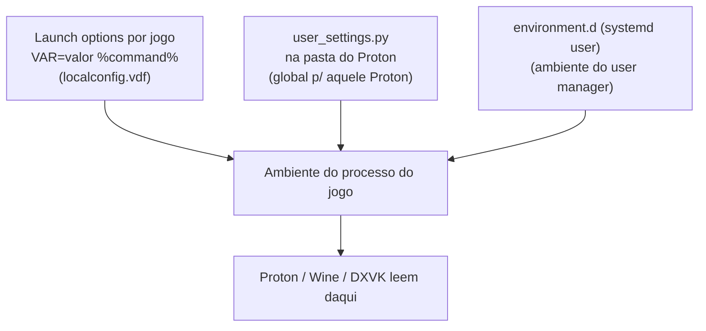

# Configurar GTA San Andreas na Steam (Linux) apenas por arquivos e linha de comando

**Slug:** `gta-sa-steam-linux` · **Data:** 2026-10-12 · **Idioma:** PT-BR

> Objetivo: mapear até onde a configuração do **Grand Theft Auto: San Andreas (clássico,
> Steam AppID 12120)** no Linux pode ser feita **somente por arquivos de texto / CLI**,
> sem usar a interface gráfica do Steam, do Proton ou do jogo. Começa pelas camadas mais
> gerais (versão do Proton, *launch options*) e desce até o específico do jogo
> (`gta_sa.set`, mods ASI).

> **Nota de integridade e verificação:** as URLs foram re-checadas em 2026-10-12; as que não
> puderam ser lidas diretamente (HTTP 403 / JS / anti-bot) estão listadas com o motivo em
> *Fontes não fetcháveis diretamente*. As citações `[n]` remetem à seção **Sources**. Os
> números foram renumerados em relação aos briefs de pesquisa, o que gerou desalinhamentos na
> primeira versão citada; esta revisão corrigiu os apontamentos do passe de revisão (ver
> *Changelog de revisão*). Nenhuma verificação foi executada em uma máquina real: todo o
> conteúdo é **documental**.

---

## Executive summary

1. **Quase toda a "casca" (Steam/Proton/Wine) é textual.** Escolha de Proton, *launch
   options*, variáveis de ambiente, verbos do Winetricks, *overrides* de DLL, registro do
   Wine, HUD e pós-processamento têm superfície de arquivo/CLI documentada
   [1][2][6][7][15][16][39][42][44][45].
2. **A config do próprio GTA SA é o gargalo.** O jogo guarda **tudo** em um único arquivo
   **binário** com *offsets* documentados, `gta_sa.set` (vídeo, áudio, controles, idioma)
   [23][24]. Não há `.ini` de configuração do jogo e **não foi encontrado editor CLI**; os
   *offsets* são editáveis por hex/script, mas o arquivo é regravado ao sair do jogo e a
   edição fina (remapear keybinds, escolher resolução arbitrária) na prática passa pela GUI
   in-game [23][37].
3. **Modding é textual.** SilentPatch, Widescreen Fix, ASI Loader e ModLoader instalam-se
   copiando arquivos; os comportamentos são ajustáveis por `.ini` (ex.: `SilentPatchSA.ini`,
   `GTASA.WidescreenFix.ini`) [31][32][33][35][36][37][38].
4. **Os limites reais do "só texto"** são: (a) **autenticação Steam/Steam Guard** [49],
   (b) uma **sessão Steam autenticada** para disparar o jogo [13], e (c) a **necessidade de
   um display** (X11 real ou Xvfb) para Wine/jogo [50][53][54]. Em resumo: **não é a
   configuração do *Steam/Wine* que exige GUI — é o *login* e o *display*.** A exceção
   verdadeira é a **config interna do jogo** (`gta_sa.set`), que não tem editor CLI.
5. **AppID 12120: aposentado, mas metadados ainda servidos.** O SteamDB marca
   `app_retired_publisher_request` [27] e a Store API `appdetails?appids=12120` retorna
   `success: true` **com `package_groups: []`** (metadados sem pacote comprável, sem
   `price_overview`) [25]. Isso **não é uma contradição**: é o comportamento esperado de um
   app retirado da venda [25][27].

### Resposta curta à pergunta geral ("até onde dá?")

> Dá para levar **instalação → configuração → lançamento** de um jogo Steam/Wine por texto
> **desde que** exista (a) uma sessão Steam já autenticada [49][13], (b) um display (real ou
> virtual, via Xvfb) [50][53][54] e (c) o jogo não dependa de um *launcher*/UI interna
> obrigatória de primeira execução [3][23]. Para o GTA SA, o único pedaço que **realmente**
> resiste ao "só texto" é a **config interna gravada em `gta_sa.set`** (controles, e escolha
> de resolução além da lista enumerada) [23].

---

## Como ler este relatório (convenções)

| Rótulo | Significado |
|---|---|
| 🟩 **texto** | Editável por editor de texto / CLI diretamente |
| 🟨 **texto gerido** | É texto, mas normalmente escrito por uma ferramenta (e pode ser sobrescrito) |
| 🟥 **binário** | Não editável por texto simples; exige hex/editor específico ou a GUI do jogo |
| **verificado** | Lido diretamente na fonte citada (fetch) |
| **inferência** | Deduzido de ≥2 fontes; não é frase literal da fonte |
| **não verificado** | Fonte fraca, ausente, ou só relato de comunidade |

---

## 1. Camada Steam: escolher a versão do Proton sem GUI

A escolha da ferramenta de compatibilidade por jogo não fica só na interface — ela é
persistida em **`config.vdf`** [7][9].

| O que | Arquivo / chave | Texto? | Fonte |
|---|---|---|---|
| Forçar Proton por jogo | `~/.local/share/Steam/config/config.vdf` (ou `~/.steam/steam/config/config.vdf`) → `InstallConfigStore > Software > Valve > Steam > CompatToolMapping > "<appid>" > name` | 🟨 | [7][9] |
| Estrutura de cada entrada | `"<appid>" { "name" "<tool>" "config" "" "Priority" "<n>" }`; a entrada `"0"` é o **default global** | 🟨 | [9] |
| Valor de `name` | Nome interno: `proton_experimental`, `proton_9`, `proton-stable`, ou tool custom | 🟨 | [7][9] |
| Proton custom (ex.: GE) | Colocar em `<steam>/compatibilitytools.d/<nome>/` (com `compatibilitytool.vdf`); requer **reiniciar o cliente Steam** | 🟩 + restart | [5][1] |
| Precedência (replicada pelo protontricks) | por-app → perfil Steam Deck → default do manifest → global `"0"` → `ToolMapping` legado | — | [7] |

**Ressalva crítica (verificada para `localconfig.vdf`, inferida para `config.vdf`):** a Steam
reescreve esses arquivos ao sair; **edite com o cliente fechado**, senão a alteração é
desfeita silenciosamente [10]. A fonte que afirma isso fala de `localconfig.vdf`; para
`config.vdf` é **inferência** por analogia [10].

`WINEPREFIX` (e `WINEARCH`) são variáveis padrão do Wine [15][22], mas no fluxo Steam/Proton
`WINEPREFIX` **não** é a variável para apontar o prefixo de um jogo Steam: o script do Proton
define `WINEPREFIX` internamente a partir de `STEAM_COMPAT_DATA_PATH` [4]. Para forçar um
prefixo custom, a via é `STEAM_COMPAT_DATA_PATH=<path> %command%` [6].

---

## 2. Camada Steam: *launch options* sem GUI

As *launch options* por jogo ficam em **`localconfig.vdf`** [10][11].

| O que | Arquivo / chave | Fonte |
|---|---|---|
| *Launch options* por app | `~/.local/share/Steam/userdata/<SteamID3>/config/localconfig.vdf` → `UserLocalConfigStore > Software > Valve > Steam > apps > <appid> > LaunchOptions` | [10][11] |
| Formato do valor | `"PROTON_USE_WINED3D=1 %command%"` — o `%command%` é o placeholder que a Steam substitui pelo comando real e é **obrigatório** para env vars/wrappers | [1] |
| Lançar sem clicar | `steam -applaunch 12120 [args]` ou `steam://rungameid/12120//[args]` | [13][12] |
| Edição em massa por script | Ferramentas leem/escrevem `localconfig.vdf` direto e checam se a Steam está rodando antes de gravar | [10] |

---

## 3. Camada de ambiente: onde as variáveis viram "arquivo"

Há **dois** mecanismos por arquivo e **um** por jogo [1][2][14]:



| Mecanismo | Escopo | Arquivo / como | Texto? | Fonte |
|---|---|---|---|---|
| *Launch options* | **por jogo** | `VAR=valor %command%` | 🟨 | [1] |
| `user_settings.py` | **global, por instalação de Proton** | Renomear `user_settings.sample.py` → `user_settings.py` na pasta do Proton (ex.: `~/.steam/steam/steamapps/common/Proton 11.0/`) e editar o dict | 🟩 | [1][2][4] |
| `environment.d` (systemd user) | **ambiente do `systemd --user`** (processos iniciados por ele) | `~/.config/environment.d/*.conf`, `/etc/environment.d/*.conf` | 🟩 | [14] |

> Nota (W11): `environment.d(5)` alimenta o **systemd user manager**; processos que não são
> iniciados por ele (p. ex. um Steam lançado de um desktop session que não importa esse
> ambiente) podem **não** herdar essas variáveis. "Sessão inteira" é uma simplificação
> [14].

### Variáveis `PROTON_*` documentadas (README oficial do Proton)

| Variável | Efeito |
|---|---|
| `PROTON_LOG` | Log de debug em `$PROTON_LOG_DIR/steam-$APPID.log` (`1` = default) [2] |
| `PROTON_LOG_DIR` | Diretório dos logs (default = home) [2] |
| `PROTON_USE_WINED3D` | Usa wined3d/OpenGL em vez de DXVK (d3d9/10/11) [2] |
| `PROTON_NO_D3D11` / `PROTON_NO_D3D10` | Desabilita `d3d11.dll` / `d3d10.dll`+`dxgi.dll` [2] |
| `PROTON_DXVK_D3D8` | Usa o `d3d8.dll` do DXVK [2] |
| `PROTON_NO_FSYNC` / `PROTON_NO_NTSYNC` | Desliga fsync / ntsync [2] |
| `PROTON_NO_ESYNC` | **Obsoleto no Proton 11.0** (existia em versões antigas) [2] |
| `PROTON_DISABLE_NVAPI` | **Desliga** a NVAPI (config string `disablenvapi`; presente no 9.0+) [2] |
| `PROTON_FORCE_NVAPI` | **Força** a NVAPI (config string `forcenvapi`; presente no script do 11.0) [66] |
| `PROTON_FORCE_LARGE_ADDRESS_AWARE` | Força LARGE_ADDRESS_AWARE (**habilitado por default** no 11.0) [2] |
| `PROTON_HIDE_NVIDIA_GPU`, `PROTON_SET_GAME_DRIVE`, `PROTON_HEAP_DELAY_FREE`, `WINE_FULLSCREEN_INTEGER_SCALING` | Diversos [2] |
| `cmdlineappend:...` | Anexa argumentos à linha do jogo [2] |

> ⚠️ **Correção sobre NVAPI (revisada):** a afirmação de que `PROTON_ENABLE_NVAPI` "não
> existe nas docs" estava **errada**. Ela **foi** uma variável documentada do Proton nas
> versões **6.3, 7.0 e 8.0** — `enablenvapi` / `PROTON_ENABLE_NVAPI`, "Enable NVIDIA's NVAPI
> GPU support library" [62][63][64]. O que muda: a partir do **Proton 9.0** ela foi
> substituída por `PROTON_DISABLE_NVAPI` (`disablenvapi`) e `PROTON_FORCE_NVAPI`
> (`forcenvapi`), com NVAPI **ligada por default** [2][65][66]. Portanto:
> **no Proton 9.0+ (incl. 11.0) `PROTON_ENABLE_NVAPI` é inerte; no Proton 6.3–8.0 ela é
> funcional.** Rotule conforme a versão do Proton, não como "no-op" universal.

### Variáveis `DXVK_*` (lidas do ambiente do jogo)

`DXVK_HUD` (opções `fps`, `devinfo`, `frametimes`, …; `=1` = `devinfo,fps`), `DXVK_CONFIG_FILE`
(aponta o `dxvk.conf`; default = CWD do jogo), `DXVK_CONFIG` (inline), `DXVK_LOG_LEVEL`,
`DXVK_LOG_PATH`, `DXVK_STATE_CACHE`/`DXVK_STATE_CACHE_PATH`, `DXVK_FRAME_RATE` [39][40][41].
Confiança: alta para `DXVK_CONFIG_FILE` [39] e `DXVK_HUD` [40][41]; **média** para
`DXVK_STATE_CACHE*`/`DXVK_FRAME_RATE` (aparecem no README do fork `ValveSoftware/dxvk` e no
README suplementar de fork, mas não no README cru do `doitsujin/dxvk`) [40][41].

### `PROTON_LOG` gera `~/steam-<appid>.log`?

**Sim, verificado.** `PROTON_LOG=1` grava em `$HOME/steam-$STEAM_APP_ID.log`, sobrescrevendo
log anterior de mesmo nome [3]; para o GTA SA (AppID 12120) → `~/steam-12120.log`
(**inferência** do padrão + AppID confirmado [25]).

---

## 4. Camada do prefixo Wine (onde a config "de sistema" vive)

O prefixo do jogo fica em **`<library>/steamapps/compatdata/<appid>/pfx/`** (um `compatdata`
por biblioteca) [3] → para o GTA SA, `~/.local/share/Steam/steamapps/compatdata/12120/pfx/`
(**inferência** do padrão + AppID confirmado [25]).

| Arquivo | Conteúdo | Texto? | Editável com segurança |
|---|---|---|---|
| `system.reg` | `HKEY_LOCAL_MACHINE` | 🟩 | Só com o Wine **parado** [21][61] |
| `user.reg` | `HKEY_CURRENT_USER` (inclui `HKCU\Software\Wine`, onde o `winecfg` grava) | 🟩 | Só com o Wine **parado** [21][61] |
| `userdef.reg` | `HKEY_USERS\.Default` | 🟩 | Só com o Wine **parado** [21][61] |
| `wine.userreg` | `HKEY_USERS` (save-only; não é carregado) | 🟩 | — [21][61] |
| `compatdata/12120/version` | ex.: `11.0-100` | 🟩 | Gerado pelo Proton [4] |
| `compatdata/12120/config_info` | snapshot: versão, mtime do registry default, flags wined3d/dxvk/d3d8/nvapi | 🟩 | Gerado pelo Proton [4] |

**Regra de ouro:** editar `.reg` à mão só com o Wine parado, senão as alterações são
descartadas [21]. O caminho canônico e mais seguro é **`wine reg`** (`add`/`import`/`export`)
[15][17] ou `protontricks` [6], que operam sem abrir o `regedit` gráfico [17].

---

## 5. Camada do jogo: `gta_sa.set` — o único 🟥 de verdade

**Não existe `.ini` de configuração do GTA SA.** Tudo (vídeo, áudio, controles, idioma,
legendas, radar) vive em um único arquivo **binário** com *offsets* documentados: `gta_sa.set`
[23][24].

- **Caminho no prefixo:** `.../compatdata/12120/pfx/drive_c/users/steamuser/My Documents/GTA
  San Andreas User Files/gta_sa.set` [51][24].
  ⚠️ Fontes divergem entre `My Documents` e `Documents` — **verificar** listando
  `drive_c/users/steamuser/` na instalação (pode variar com a versão do Proton) [51][24][57].
- **Ciclo de vida:** o arquivo é **regravado a cada saída do jogo** [23]; a issue oficial do
  Proton para o 12120 menciona `My Documents` como necessário para salvar [57]. A afirmação
  mais forte de que "só é criado após rodar o jogo" é **plausível mas não está na fonte
  fetchável citada** — tratar como **não verificado**.
- **Editabilidade:** a comunidade mapeou **offsets fixos** e edita por hex [23].

| Config no `gta_sa.set` | Offset |
|---|---|
| Resolução (índice enumerado) | `0xB36` [23] |
| Wide Screen on/off | `0xB34` [23] |
| Frame Limiter | `0xB35` [23] |
| Draw distance | `0xB30` [23] |
| Visual FX quality / Mip Mapping / Antialiasing | `0xB2A` / `0xB24` / `0xB26` [23] |
| Brightness | `0xB20` [23] |
| Volume Radio / SFX | `0xB1C` / `0xB1B` [23] |
| Mouse sensitivity | `0xB14` (dword) [23] |
| Modo Mouse+Keys vs Joypad | `0xB3A` [23] |
| Idioma | `0xB3B` [23] |
| Keybinds | pares de 2 bytes (vkey + estado), foot/vehicle controls [23] |

**Limitação honesta (revisada):** não foi encontrado **editor CLI** de `gta_sa.set`. O GTAMods
Wiki [23] publica uma **tabela nomeada de ações → offsets** (Fire, Jump, Sprint, Aim, Crouch,
Action, Walk, veículos, etc.), então o mapa **não é** comprovadamente "incompleto"; a ressalva
correta é: os offsets existem, mas (a) não há ferramenta CLI e (b) o arquivo é regravado ao
sair, então edições manuais competem com o jogo. Ferramentas GUI conhecidas (ex.: *GTA SA
Control Center*) usam arquivos **próprios** e **não** editam o `.set` do jogo [60] (fonte não
fetchável — HTTP 403). Trocar keybinds 100% por texto permanece **não resolvido na prática**,
mas o motivo é a **ausência de editor CLI**, não um mapa textual incompleto [23].
**Status: parcialmente bloqueado.**

### Resolução sem GUI

| Abordagem | Veredito | Fonte |
|---|---|---|
| Flags de launch `-width`/`-height` | **Não há flags de resolução documentadas para o SA clássico** em [23] (a resolução é um índice no `.set`). A atribuição dessas flags ao GTA IV não foi confirmada em fonte → **não verificado**. | [23] |
| Hex no índice `0xB36` | Só aceita os valores **enumerados** (640×480, 720×576, 800×600, 1024×768, 16/32-bit) | [23] |
| **Widescreen Fix** | Desbloqueia todas as resoluções, mas a **seleção continua na GUI in-game** | [37][38] |
| `wndmode.ini` do ASI Loader | Força **modo janela** (cria .ini vazio; é preenchido na 1ª execução) | [31] |
| Wrapper externo (`gamescope`/dgVoodoo2) | Escala/resolução forçadas **fora** do jogo | [42][67] |

> A afirmação de que apagar o `.set` reseta para **800×600** **não foi mantida**: a única
> fonte era a PCGamingWiki (HTTP 403, descartada). Ver *Removed Unsupported Claims*.

---

## 6. Modding por arquivo (instalação "copiar e pronto")

| Mod | Arquivos | Instalação | `.ini`? |
|---|---|---|---|
| **Ultimate ASI Loader** | DLL proxy (`dinput8.dll`, `d3d9.dll`, `dsound.dll`, `vorbisFile.dll`, …) | Copiar a DLL na pasta do jogo; ASI vão na raiz ou em `scripts/`, `plugins/`, `update/`; Bink DLLs exigem renomear o original p/ `<nome>Hooked.dll` | Sim: `global.ini` (`[GlobalSets]`, `[FileLoader]`, `LoadPlugins`, `UseD3D8to9`, …) [31] |
| **Silent's ASI Loader** | `vorbisFile.dll` + `vorbisHooked.dll` | Substitui `vorbisFile.dll` do jogo (**backup antes**) | não [34][56] |
| **SilentPatch (SA)** | `SilentPatchSA.asi` + `SilentPatchSA.ini` | Copiar para a raiz (precisa de ASI Loader) | Sim: `SkipIntroSplashes`, `UseDesktopRefreshRate`, `EnableScriptFixes`, … [32][33] |
| **Mod Loader** | plugin `.asi` + pasta `modloader/` | Jogar mods em `modloader/<mod>/`; **nunca altera arquivos originais** (injeção em runtime) | — [35] |
| **CLEO 5** | `CLEO.asi` + pasta `cleo/`, plugins em `cleo\cleo_plugins\`, scripts `.cs` em `cleo\` | Extrair na raiz; **requer ASI Loader**; a build já vem com Silent's ASI Loader | — [36][34] |
| **Widescreen Fix** | `GTASA.WidescreenFix.asi` + `scripts/GTASA.WidescreenFix.ini` | Copiar `.asi`+`.ini` (normalmente via `modloader/WidescreenFix/`) | Sim: `[GRAPHICS]`, `[MISC]` (`HudAspectRatioConstraint`, `RadarWidth`, `SMAA`, `FullscreenMap`, …) [37][38] |
| **dgVoodoo2** | DLLs + `dgVoodoo.conf` | Copiar DLLs; wrapper DirectX/Glide (o workflow `dgVoodooCpl.exe`/`dgVoodoo.conf` **não** é documentado na página oficial — **não verificado**) | Não verificado [67] |
| **ReShade** | DLL + `ReShade.ini` + presets `.ini` | Instalador/GUI; `ReShade.ini` e presets `.ini` são editáveis (o `ReShade.ini` lista `[GENERAL] PresetFiles`) | Sim (gerido) [68][70] |

**Regra:** plugins `.asi` **sempre** precisam de um ASI Loader ativo; os `.ini` irmãos são
opcionais [31][32][36].

---

## 7. Ferramentas CLI que substituem a GUI

| Ferramenta | O que faz headless | Comando-chave | Fonte |
|---|---|---|---|
| **protontricks** | Roda verbos do Winetricks no prefixo Proton; roda comando arbitrário | `protontricks 12120 d3dx9`; `protontricks -c "<cmd>" 12120`; `protontricks -l` / `-s <nome>`; `protontricks-launch --appid 12120 <exe>` | [6] |
| **winetricks** | Instala DLLs/fonts e aplica tweaks; `-q` não pergunta nada | `WINEPREFIX=<pfx> winetricks -q d3dx9 d3dcompiler_43` | [16][55] |
| **wine reg / regedit** | Edição de registro 100% CLI | `wine reg add "HKCU\\Software\\X" /v Nome /t REG_SZ /d valor /f`; `wine reg import file.reg`; `wine regedit file.reg` (importa silencioso) | [15][17] |
| **wineboot / wineserver** | Inicializa prefixo / mata servidor | `wineboot --init`; `wineserver -k` | [18][19] |
| **winecfg** | **Não é headless**: sem args abre GUI; único uso CLI é `winecfg -v win7` (seta versão e sai) | `winecfg -v win7` | [20] |
| **steamtinkerlaunch** | Wrapper de launch options; config 100% por arquivo; CLI funciona sem Steam aberto ("several ... useful without steam running") | config em `~/.config/steamtinkerlaunch/` (`global.conf`, `gamecfgs/id/<APPID>.conf`); launch `steamtinkerlaunch %command%` | [8][69] |
| **gamescope** | Micro-compositor com backend **headless** explícito | `gamescope -w 1920 -h 1080 -W 1920 -H 1080 -r 60 -- %command%`; `--backend headless` (sem janela/saída DRM) | [42][43] |
| **MangoHud** | Overlay HUD | `MANGOHUD_CONFIG=...`; `~/.config/MangoHud/<app>.conf`; `MANGOHUD_CONFIGFILE=` | [44] |
| **vkBasalt** | Pós-processamento Vulkan (CAS/FXAA/SMAA) | `ENABLE_VKBASALT=1 %command%`; `VKBASALT_CONFIG_FILE=`; default em `~/.config/vkBasalt/vkBasalt.conf` | [45] |
| **DXVK** | Camada D3D→Vulkan | `dxvk.conf` no CWD **ou** `DXVK_CONFIG_FILE=`; seção `[app.exe]` para override | [39] |
| **Lutris** | Instala por YAML, roda por URI, gera script bash | `lutris -i jogo.yml`; `lutris lutris:rungameid/<id>`; `lutris -b` | [48] |
| **Bottles** | CLI dedicada | `bottles-cli reg -b BOTTLE -k KEY -v VALUE -t TIPO add`; `bottles-cli edit -b BOTTLE --env-var WINEDEBUG=-all` (config por arquivo existe, mas é "not recommended to modify these files by hand" [47]) | [46] |
| **SteamCMD** | Cliente Steam por CLI | `steamcmd +login <user> +app_update 12120 +quit` | [49] |
| **Xvfb / xvfb-run** | Display X virtual p/ rodar Wine sem monitor | `xvfb-run -a -s "-screen 0 1024x768x24" wine app.exe` | [50] |

---

## 8. Onde o "só texto" realmente quebra

Estes são os pontos em que a cadeia 100% textual exige uma etapa interativa ou um display —
**não é a configuração do *Steam/Wine* que trava, é o login e o display** (a exceção é a
config interna do jogo) [49][50][23]:

| Limite | Por quê | Fonte |
|---|---|---|
| **Steam Guard / 2FA** | `steamcmd +login` exige o código do Guard na primeira vez ("enter it... only required the first time") | [49] |
| **Jogo comercial via SteamCMD** | Conta anônima baixa sobretudo conteúdo anônimo (majoritariamente servidores dedicados); jogo comprado exige login com a conta dona ("No subscription") — para o 12120 é **inferência** (não há fonte específica) | [49] |
| **Sessão Steam autenticada** | `steam -applaunch <appid>` precisa de conta logada que **possua** o jogo; o cliente Steam **se inicia sozinho** se não estiver rodando (a issue histórica #3474 foi **fechada como corrigida** em 2014) | [13][58] |
| **Display para Wine** | Wine exige `$DISPLAY`; sem monitor, usa-se Xvfb | [53][50] |
| **Jogo 3D headless de verdade** | Exige GPU/llvmpipe + Xvfb e frequentemente falha (vertex processing, fullscreen) | [54] |
| **gamescope `--backend headless`** | O backend existe (`no window, no DRM output`) e é **intencionado** para streaming/VR, mas há issue aberta relatando que não renderiza imagem além do cursor sob Steam Link — ou seja, não serve para "ver o jogo" nem, no relato, para streaming | [42][43] |
| **DRM/primeira execução do jogo** | A ficha de loja lista "Software installations required including DirectX and Sony DADC SecuROM" [25][26]; **não foi confirmado** se a build Steam exige ativação interativa. A issue oficial do Proton para o 12120 relata que o jogo "launches without any errors" sob Proton | [25][26][57] |
| **config interna do jogo** | `gta_sa.set` é binário; a edição fina (remapear keybinds, resolução arbitrária) não tem editor CLI e é regravada ao sair | [23][37] |

---

## 9. Receita prática: GTA SA configurado por texto (fluxo mínimo)

> **Aviso (W5):** este fluxo **não foi executado** em uma máquina real nesta pesquisa — é
> montado a partir de documentação, não validado. Rótulos: **[T]** = só texto/CLI;
> **[D]** = precisa de display; **[I]** = precisa de interação.

1. **[I]** Ter a conta Steam autenticada (uma vez; resolve o Steam Guard) [49].
2. **[T]** Fechar o Steam. Editar `config.vdf` para fixar o Proton desejado em
   `CompatToolMapping > "12120"` [7][9].
3. **[T]** Em `localconfig.vdf > ... > apps > 12120 > LaunchOptions`, escrever as env vars
   [10][11]:
   ```text
   PROTON_LOG=1 DXVK_HUD=0 %command%
   ```
4. **[T]** *(opcional, global)* Criar `user_settings.py` na pasta do Proton para defaults [1][2].
5. **[D]** Primeira execução do jogo (gera o prefixo `compatdata/12120/pfx/`) — precisa de
   display (real ou Xvfb) [3][50]. Rodar uma vez para o jogo gerar `gta_sa.set` [23].
6. **[T]** Ajustar o prefixo por CLI se necessário:
   ```bash
   protontricks 12120 d3dx9
   wine reg add "HKCU\Software\Wine\DllOverrides" /v dinput8 /t REG_SZ /d "native,builtin" /f
   ```
   [6][15][17] (o *override* `dinput8` é **não verificado** para o SA — ver §10)
7. **[T]** Instalar mods copiando arquivos: ASI Loader (`dinput8.dll`) + `SilentPatchSA.asi` +
   `SilentPatchSA.ini` + `modloader/` + Widescreen Fix `.asi`/`.ini` [31][32][33][35][37][38].
8. **[T]** Gerar/editar configs de wrapper: `dxvk.conf`, `MangoHud.conf`, `vkBasalt.conf`
   [39][44][45].
9. **[D+T]** Rodar: `steam -applaunch 12120` (com display ativo; a Steam se inicia sozinha se
   necessário, desde que a conta esteja logada) [13], ou via Xvfb para validação sem tela [50].
10. **[T→partial]** Controles/resolução: copiar config de `gta_sa.set` de outra máquina [51],
    hex-editar offsets conhecidos [23], ou aceitar a GUI in-game para a escolha fina [37].

**O que só a GUI do jogo resolve bem:** remapear keybinds e escolher resoluções arbitrárias
(via Widescreen Fix), porque o resultado é gravado no `gta_sa.set` binário e **não há editor
CLI** [23][37].

---

## 10. Caveats, desacordos e incertezas

- **AppID 12120 aposentado, metadados ainda servidos.** O SteamDB marca
  `app_retired_publisher_request` e a página de loja exibe "no longer available on the Steam
  store" [26][27]; a Store API retorna `success: true` **com `package_groups: []`** e **sem
  `price_overview`** — metadados sem pacote comprável [25]. **Não é contradição**: é o
  comportamento esperado de um app retirado. Quem já possui continua jogando; novos usuários
  não conseguem comprar — o `package_groups: []` de [25] sustenta isso; o estado de
  aposentadoria em si vem de [27] (**403, não verificado**).
- **AppIDs do pacote.** Segundo o SteamDB, o mesmo pacote Steam conteria 12120 (conteúdo
  Windows) e 12250 (depot macOS) [28]; a **Definitive Edition** é um produto separado
  (1547000) [29]. *Fontes 403 no fetch direto → **não verificadas** nesta pesquisa.*
- **`Documents` vs `My Documents`** no perfil do prefixo: divergência entre fontes; as fontes
  comunitárias fetcháveis usam `My Documents` [51][24] e a issue oficial do Proton também
  [57]; **verificar** na instalação.
- **`PROTON_ENABLE_NVAPI`**: **documentada nas versões 6.3–8.0** [62][63][64]; substituída por
  `PROTON_DISABLE_NVAPI`/`PROTON_FORCE_NVAPI` (NVAPI ligada por default) no 9.0+ [2][65][66].
  Inerte apenas no 9.0+.
- **`dinput8=n,b` para ASI no GTA SA**: o gist [52] associa `WINEDLLOVERRIDES="dinput8=n,b"`
  a **outro** jogo (Monster Hunter Rise), **não** a GTA; a necessidade específica para o SA é
  **não verificada** (normalmente DLLs locais já são usadas).
- **`wsh57`**: necessidade para GTA SA **não confirmada** (nenhuma fonte).
- **Conjunto canônico de verbos Winetricks "para GTA SA"**: **não existe** fonte primária; só
  indicação genérica de jogos DX9 + relato de comunidade (`d3dx9_43`) [52][55]. `directplay` só
  importa para multiplayer legado, já que o SilentPatch remove a dependência de DirectPlay no
  single-player [32].
- **`GTA SA Control Center` e fóruns GTA** retornaram HTTP 403 nos fetches diretos; a conclusão
  "não há editor CLI" vem de fontes comunitárias indexadas, não de leitura direta [60].
- **`DXVK_STATE_CACHE*`, `DXVK_FRAME_RATE`**: presentes no README do fork `ValveSoftware/dxvk`
  e no README suplementar de fork, ausentes no README cru do `doitsujin/dxvk` → confiança média
  [39][40][41].
- **`WINEESYNC`/`WINEFSYNC`**: sem doc oficial do Wine localizada; só fontes comunitárias.
  Para Steam, prefira `PROTON_NO_FSYNC`/`PROTON_NO_ESYNC` [2][52].
- **Rastreabilidade das citações.** Na versão citada anterior, três citações apontavam para
  fontes que não sustentavam a linha (dgVoodoo2, ReShade, caminho do `gta_sa.set`) por colisão
  de numeração entre os briefs e o documento final. Nesta revisão: dgVoodoo2 → [67], ReShade →
  [68], caminho → [51][24][57]. Não há manifesto claim→artefato completo; a fonte de cada linha
  é a citada na própria linha.

---

## 11. Open questions

1. Confirmar o caminho exato (`Documents` vs `My Documents`) e a presença de `gta_sa.set` em
   uma instalação real com a versão de Proton atual.
2. Testar se `protontricks 12120 d3dx9` é realmente necessário no Proton atual ou se o DXVK
   já cobre o jogo (não há medição própria).
3. Construir/validar um editor CLI de `gta_sa.set` (os offsets existem; falta ferramenta) —
   candidato a pequeno experimento reprodutível.
4. Verificar se editar `config.vdf` com o Steam fechado realmente persiste (a base é a
   analogia com `localconfig.vdf`, não uma afirmação literal) [10].
5. Confirmar se a build Steam do 12120 exige qualquer interação de DRM/SecuROM na primeira
   execução [25][26].
6. Definir um procedimento headless completo (Xvfb + llvmpipe) para validar que o jogo
   inicializa e gera `gta_sa.set` sem monitor — não executado.

---

## Changelog de revisão (pós-passe de revisão)

| Item | Correção aplicada |
|---|---|
| W1 (FATAL) | `PROTON_ENABLE_NVAPI` não é "no-op universal": documentada em 6.3–8.0 [62][63][64]; substituída por `PROTON_DISABLE_NVAPI`/`PROTON_FORCE_NVAPI` no 9.0+ [2][65][66]. Tabela e caveat reescritos. |
| W2 (FATAL) | Reapontadas as citações de dgVoodoo2 → [67], ReShade → [68][70], caminho `gta_sa.set` → [51][24][57]; nota de renumeração adicionada. |
| N1/N2 (2ª pass) | `[67]` corrigido para URL viva (`/dgVoodoo2/`) e claim marcada não verificada; ReShade recitado a `[68][70]` (preset `.ini`/`ReShade.ini`). |
| N3 (2ª pass) | `-width`/`-height`: atribuição ao GTA IV removida, marcada **não verificada**. |
| N4 (2ª pass) | `dinput8=n,b` repropriedade (Monster Hunter Rise); obrigação para o SA = não verificada. |
| N5 (2ª pass) | steamtinkerlaunch CLI sem Steam agora citado a `[69]`. |
| N6 (2ª pass) | Placeholder `[26/23]` removido. |
| N7 (2ª pass) | Afirmações de `[28]`/`[27]` marcadas **não verificadas** (403). |
| W3 (MAJOR) | "800×600 default" removido do corpo → *Removed Unsupported Claims*. |
| W4 (MAJOR) | Veredito de keybinds reescrito: motivo é a **ausência de editor CLI**, não "mapa de ações incompleto"; removida a citação 403 como corroborante. |
| W5 (MAJOR) | Framing reconciliado: "não é a config do **Steam/Wine**"; a config interna do jogo é a exceção explícita. |
| W6 (MAJOR) | `-applaunch`: issue #3474 fechada como corrigida; limite correto é sessão autenticada/posse, e a Steam se inicia sozinha. |
| W7 (MAJOR) | AppID reenquadrado: `package_groups: []`, sem contradição. |
| W8 (MINOR) | gamescope headless: "intencionado para streaming/VR, mas relatado não-funcional". |
| W9 (MINOR) | "só criado após rodar o jogo" marcado não verificado. |
| W10 (MINOR) | `PROTON_FORCE_NVAPI` adicionada à tabela. |
| W11 (MINOR) | `environment.d` reescopo para o `systemd --user`. |
| W12 (MINOR) | SecuROM/DRM adicionado à seção de limites, marcado não confirmado. |

---

## Sources

1. ValveSoftware/Proton — README (env vars, `%command%`, `user_settings.py`): https://github.com/ValveSoftware/Proton
2. ValveSoftware/Proton — README (branch `proton_11.0`, tabela de Runtime Config Options): https://github.com/ValveSoftware/Proton/blob/proton_11.0/README.md
3. ValveSoftware/Proton — Proton FAQ (prefixos `compatdata/<appid>/pfx/`, `PROTON_LOG` → `$HOME/steam-$STEAM_APP_ID.log`): https://github.com/ValveSoftware/Proton/wiki/Proton-FAQ
4. ValveSoftware/Proton — script `proton` (classe `CompatData`, `version`, `config_info`, `WINEPREFIX`; leitura de `user_settings.py`): https://github.com/ValveSoftware/Proton/blob/proton_11.0/proton
5. ValveSoftware/Proton — `compatibilitytool.vdf.template` (proton_10.0): https://github.com/ValveSoftware/Proton/blob/proton_10.0/compatibilitytool.vdf.template
6. Matoking/protontricks — README (`-l`, `-s`, `-c`, `protontricks-launch`, `STEAM_COMPAT_DATA_PATH`): https://github.com/Matoking/protontricks
7. Matoking/protontricks — `src/protontricks/steam.py` (`config/config.vdf`, `CompatToolMapping`, ordem de precedência): https://github.com/Matoking/protontricks/blob/master/src/protontricks/steam.py
8. sonic2kk/steamtinkerlaunch — wiki "Configuration Files" (`global.conf`, `gamecfgs/id/<APPID>.conf`): https://github.com/sonic2kk/steamtinkerlaunch/wiki/Configuration-Files
9. sonic2kk/steamtinkerlaunch — wiki "Steam Compatibility Tool" (bloco `CompatToolMapping`, campo `name`, `Priority`): https://github.com/sonic2kk/steamtinkerlaunch/wiki/Steam-Compatibility-Tool
10. baconismycopilot/steam-launchopts — README (edita `userdata/<id>/config/localconfig.vdf`; "Steam owns localconfig.vdf and rewrites it whenever it exits"): https://github.com/baconismycopilot/steam-launchopts
11. Hintay/SLSsteam-Plus — `src/feats/launch_options.cpp` (`Software\Valve\Steam\Apps\<appid>\LaunchOptions` em `UserLocalConfigStore`): https://github.com/Hintay/SLSsteam-Plus/blob/main/src/feats/launch_options.cpp
12. note.com/okouu — "Steamゲームをブラウザやコマンドラインから起動する方法": https://note.com/okouu/n/n1015686f6bf9
13. Valve Developer Community — Command line options (Steam) (`-applaunch`): https://developer.valvesoftware.com/wiki/Command_line_options_(Steam)
14. environment.d(5) — man7.org: https://man7.org/linux/man-pages/man5/environment.d.5.html
15. wine(1) — Arch manual pages: https://man.archlinux.org/man/wine.1.en
16. winetricks(1) — Arch manual pages (`-q/--unattended`, `WINEPREFIX`): https://man.archlinux.org/man/winetricks.1
17. regedit(1) — Arch manual pages (modo CLI silencioso ao passar arquivo): https://man.archlinux.org/man/extra/wine/regedit.1.en
18. wineboot(1) — Arch manual pages: https://man.archlinux.org/man/extra/wine/wineboot.1.en
19. wineserver(1) — Arch manual pages: https://man.archlinux.org/man/wineserver.1.en
20. winecfg(1) — Arch manual pages (`-v <version>`; sem args = GUI): https://man.archlinux.org/man/winecfg.1.en.txt
21. WineHQ — Wine User's Guide: Registry Files: https://wiki.winehq.org/Wine_User%27s_Guide
22. ArchWiki — Wine (prefixos, `WINEPREFIX`, `WINEARCH`, uso de `wine reg`): https://wiki.archlinux.org/title/Wine
23. GTAMods Wiki — `gta_sa.set` (offsets de vídeo/áudio/controles/idioma; valores enumerados de resolução; tabela nomeada de ações): https://gtamods.com/wiki/Gta_sa.set
24. GTAMods Wiki — User files (`My Documents/GTA San Andreas User Files`): https://gtamods.com/wiki/User_files
25. Steam Store API — `appdetails?appids=12120` (`success: true`, `platforms.windows=true`, `package_groups: []`, release 4 Jan 2008, requisito SecuROM): https://store.steampowered.com/api/appdetails?appids=12120
26. Steam Store — página do app 12120 (requisitos com DirectX + Sony DADC SecuROM; aviso "no longer available"): https://store.steampowered.com/app/12120
27. SteamDB — GTA: San Andreas (12120) (aposentado, `app_retired_publisher_request`) — *não fetchável (403)*: https://steamdb.info/app/12120/info
28. SteamDB — Sub 7280 (apps 12120 e 12250; depot 12251 é macOS) — *não fetchável (403)*: https://steamdb.info/sub/7280/apps
29. SteamDB — GTA: San Andreas - The Definitive Edition (1547000) — *não fetchável (403)*: https://steamdb.info/app/1547000/info
30. SteamDB — GTA: San Andreas (12120) Configuration — *não fetchável (403)*: https://steamdb.info/app/12120/config
31. ThirteenAG — Ultimate ASI Loader (DLL proxy; `global.ini`; `wndmode.ini`; pastas `scripts/plugins/update`): https://github.com/ThirteenAG/Ultimate-ASI-Loader
32. CookiePLMonster — SilentPatch (repo; `SilentPatchSA.asi` + `.ini`): https://github.com/CookiePLMonster/SilentPatch
33. `SilentPatchSA.ini` (`SkipIntroSplashes`, `UseDesktopRefreshRate`, `EnableScriptFixes`): https://github.com/CookiePLMonster/SilentPatch/blob/master/Config/SilentPatchSA.ini
34. CookiePLMonster — Silent's Blog, GTA SA mods (ASI Loader): https://silentsblog.com/mods/gta-sa/
35. thelink2012 — Mod Loader (mods em `modloader/`, sem alterar originais): https://github.com/thelink2012/modloader
36. cleolibrary — CLEO5 (requer ASI Loader; `CLEO.asi`, pasta `cleo/`): https://github.com/cleolibrary/CLEO5
37. ThirteenAG — WidescreenFixesPack: https://github.com/ThirteenAG/WidescreenFixesPack
38. `GTASA.WidescreenFix.ini` (`HudAspectRatioConstraint`, `RadarWidth`, `SMAA`, `FullscreenMap`): https://github.com/ThirteenAG/WidescreenFixesPack/blob/master/data/GTASA.WidescreenFix/scripts/GTASA.WidescreenFix.ini
39. doitsujin/dxvk — Configuration wiki (`DXVK_CONFIG_FILE`, `dxvk.conf`, seção `[app.exe]`): https://github.com/doitsujin/dxvk/wiki/Configuration
40. ValveSoftware/dxvk — README (`DXVK_HUD`, `DXVK_CONFIG`, `DXVK_LOG_LEVEL`, `DXVK_LOG_PATH`, `DXVK_STATE_CACHE*`, `DXVK_FRAME_RATE`): https://github.com/ValveSoftware/dxvk
41. NVIDIAGameWorks/dxvk-remix — `dxvk_supplemental_readme.md` (`DXVK_HUD` opções; `DXVK_FRAME_RATE`; `DXVK_STATE_CACHE`): https://github.com/NVIDIAGameWorks/dxvk-remix/blob/main/dxvk_supplemental_readme.md
42. ValveSoftware/gamescope — README (`-W/-H`, `-w/-h`, `-r`, `-F`, `-S`, `-- %command%`; backend headless): https://github.com/ValveSoftware/gamescope
43. ValveSoftware/gamescope — issue #1984 "Headless backend not rendering anything apart from pointer" (OPEN): https://github.com/ValveSoftware/gamescope/issues/1984
44. flightlessmango/MangoHud (`MANGOHUD_CONFIG`, `MANGOHUD_CONFIGFILE`, `~/.config/MangoHud/<app>.conf`): https://github.com/flightlessmango/MangoHud
45. DadSchoorse/vkBasalt (`ENABLE_VKBASALT=1`, `VKBASALT_CONFIG_FILE`, locais do config): https://github.com/DadSchoorse/vkBasalt
46. Bottles — CLI docs (`bottles-cli reg/edit/run/tools`): https://docs.usebottles.com/advanced/cli
47. Bottles — Configuration files ("not recommended to modify these files by hand"): https://docs.usebottles.com/bottles/configuration-files
48. lutris(1) — Arch manual pages (`-i`, `lutris:rungameid/`, `-b`): https://man.archlinux.org/man/lutris.1.en
49. Valve Developer Community — SteamCMD (`+login`, Steam Guard na 1ª vez, erro "No subscription") — *bloqueio anti-bot no fetch direto*: https://developer.valvesoftware.com/wiki/SteamCMD
50. xvfb-run(1) — Debian Manpages: https://manpages.debian.org/testing/xvfb/xvfb-run.1.en.html
51. Steam Community — "How can i copy my windows save file of gta sa here on linux?" (caminho `compatdata/12120/pfx/drive_c/users/steamuser/My Documents/GTA San Andreas User Files`): https://steamcommunity.com/app/12120/discussions/0/1746771666830860701/
52. SeongGino — Linux Windows Games Compatibility List (GTA SA: "needs d3dx9"; `WINEDLLOVERRIDES="dinput8=n,b"`; `DXVK_FRAME_RATE`): https://gist.github.com/SeongGino/b2ef5939af497f6d9336e3440ca52d6c
53. WineHQ forum — "I NEED START WINE WITHOUT DISPLAY": https://forum.winehq.org/viewtopic.php?t=1390
54. Super User — "Run wine totally headless": https://superuser.com/questions/902175/run-wine-totally-headless
55. Winetricks — `files/verbs/dlls.txt` (existência do verbo `d3dx9`): https://github.com/Winetricks/winetricks/blob/master/files/verbs/dlls.txt
56. Steam Community — Guide "Silent Patch + Downgraders (SA)" (`SilentPatchSA.asi`, `vorbisHooked.dll`, `vorbisFile.dll`): https://steamcommunity.com/sharedfiles/filedetails/?id=641831651
57. ValveSoftware/Proton — issue #143 "GTA: San Andreas (12120)" (`My Documents` necessário para salvar; "launches without any errors"): https://github.com/ValveSoftware/Proton/issues/143
58. ValveSoftware/steam-for-linux — issue #3474 (`-applaunch`; **CLOSED/COMPLETED 2014**, "It's all fixed now") — *fonte histórica, superada*: https://github.com/ValveSoftware/steam-for-linux/issues/3474
59. GTAForums — "Structure of gta_sa.set" — *não fetchável (HTTP 403)*: https://gtaforums.com/topic/452325-structure-of-gta_saset
60. GTA SA Control Center — Configuration Files (ferramenta GUI usa arquivos próprios, não o `.set`) — *não fetchável (HTTP 403)*: https://documentation.help/GTA-SA-Control-Center/config_files.html
61. wine-mirror/wine — `server/registry.c` (mapeamento `system.reg`→Machine, `userdef.reg`→User\.Default, `user.reg`→HKCU): https://github.com/wine-mirror/wine/blob/master/server/registry.c
62. ValveSoftware/Proton — README (branch `proton_8.0`): `enablenvapi` / `PROTON_ENABLE_NVAPI` documentada, sem `PROTON_DISABLE_NVAPI`: https://raw.githubusercontent.com/ValveSoftware/Proton/proton_8.0/README.md
63. ValveSoftware/Proton — README (branch `proton_7.0`): `enablenvapi` / `PROTON_ENABLE_NVAPI` documentada: https://raw.githubusercontent.com/ValveSoftware/Proton/proton_7.0/README.md
64. ValveSoftware/Proton — README (branch `proton_6.3`): `enablenvapi` / `PROTON_ENABLE_NVAPI` documentada: https://raw.githubusercontent.com/ValveSoftware/Proton/proton_6.3/README.md
65. jp7677/dxvk-nvapi — README (Proton 9.0+ com NVAPI ligada por default; `PROTON_FORCE_NVAPI`/`PROTON_DISABLE_NVAPI`): https://github.com/jp7677/dxvk-nvapi/blob/master/README.md
66. ValveSoftware/Proton — script `proton` (branch `proton_11.0`): `check_environment("PROTON_DISABLE_NVAPI", "disablenvapi")` e `check_environment("PROTON_FORCE_NVAPI", "forcenvapi")`: https://raw.githubusercontent.com/ValveSoftware/Proton/proton_11.0/proton
67. Dege — dgVoodoo2 (site oficial; wrapper DirectX/Glide): https://dege.freeweb.hu/dgVoodoo2/ — *a página não documenta o workflow `dgVoodooCpl.exe`/`dgVoodoo.conf` (parte não verificada)*
68. ReShade — site oficial (preset files `*.ini`): https://reshade.me/
69. sonic2kk/steamtinkerlaunch — wiki "Command Line" ("several of them are also useful without steam running"): https://github.com/sonic2kk/steamtinkerlaunch/wiki/Command-Line
70. ReShade Forum — "Loading Preset .ini Config Outside of ReShade GUI" (`ReShade.ini` → `[GENERAL] PresetFiles`): https://reshade.me/forum/general-discussion/5064-loading-preset-ini-config-outside-of-reshade-gui

### Fontes não fetcháveis diretamente (verificação de URL)

| URL | Status no fetch | Tratamento |
|---|---|---|
| [13] `developer.valvesoftware.com/wiki/Command_line_options_(Steam)` | Bloqueio anti-bot (Anubis) | Conteúdo confirmado via índice de busca; mantida |
| [49] `developer.valvesoftware.com/wiki/SteamCMD` | Bloqueio anti-bot (Anubis) | Texto do Steam Guard confirmado via resultado indexado; mantida |
| [21] `wiki.winehq.org/Wine_User%27s_Guide` | Página JS-renderizada | Mantida como canônica; mapeamento `.reg` também coberto por [61] e man pages [15][17] |
| [27] `steamdb.info/app/12120/info` | HTTP 403 | Confirmada via busca indexada (`app_retired_publisher_request`, "no longer available") |
| [28] `steamdb.info/sub/7280/apps` | HTTP 403 | Fonte secundária do agente de pesquisa; não re-fetchada |
| [29] `steamdb.info/app/1547000/info` | HTTP 403 | Fonte secundária do agente de pesquisa; não re-fetchada |
| [30] `steamdb.info/app/12120/config` | HTTP 403 | Não re-fetchada; usada só como referência de config |
| [59] `gtaforums.com/topic/452325-structure-of-gta_saset` | HTTP 403 | Fonte comunitária; conclusões marcadas como não verificadas |
| [60] `documentation.help/GTA-SA-Control-Center/config_files.html` | HTTP 403 | Fonte comunitária; conclusão marcada como não verificada |

**Fontes verificadas diretamente nesta revisão (fetch):** `proton_8.0/README.md` (contém
`PROTON_ENABLE_NVAPI`) [62]; `proton_11.0/README.md` (contém `PROTON_DISABLE_NVAPI`, não
`PROTON_ENABLE_NVAPI`) [2]; script `proton` do 11.0 (contém `PROTON_FORCE_NVAPI`) [66];
`appdetails?appids=12120` (`package_groups: []`, sem `price_overview`) [25].

URLs **descartadas**: `https://www.pcgamingwiki.com/wiki/Grand_Theft_Auto:_San_Andreas`
(HTTP 403; era a única fonte do caminho `Documents`, da descrição "encrypted" e do default
800×600). Ver **Removed Unsupported Claims**.

---

## Removed Unsupported Claims

- **Descrição de `gta_sa.set` como "encrypted"/"obfuscado".** A única fonte era a PCGamingWiki
  (HTTP 403, não fetchável). O GTAMods Wiki [23] descreve o arquivo como **binário com offsets
  documentados** e não usa o termo "encrypted". O texto usa **"binário"**.
- **Caminho `.../steamuser/Documents/...`.** A variante `Documents` vinha da PCGamingWiki (403).
  As fontes fetcháveis usam `My Documents` [24][51][57].
- **Default "800×600" ao apagar `gta_sa.set`.** Sem fonte fetchável (vinha da PCGamingWiki 403).
  **Removido** nesta revisão (W3). Se for necessário, verificar empiricamente.
- **"Mapa de ações do teclado incompleto".** A única fonte era o GTAForums [59] (HTTP 403);
  o GTAMods Wiki [23] publica tabela nomeada de ações → offsets, o que **contradiz** o rótulo
  forte. Reescrito para "falta editor CLI" (W4).

*Nota de integridade* (revisada): cada linha técnica cita a fonte que a sustenta; onde a
evidência é comunitária, o texto marca "não verificado" ou "inferência"; onde a fonte é
bloqueada, o motivo está em *Fontes não fetcháveis*. Nenhum número, tabela ou benchmark foi
inventado. Nada foi executado em máquina real nesta pesquisa (conteúdo documental).
